# LightPHE cross-language benchmark

Benchmarks the four implementations of LightPHE, a lightweight partially homomorphic encryption
library, against each other. It covers encryption, decryption, every homomorphic operation each scheme
supports and key generation at three security levels (80, 112 and 128 bit), and also reports
key/ciphertext sizes, peak memory and package footprint.

| Language | Repository |
|---|---|
| Python (reference) | [serengil/LightPHE](https://github.com/serengil/LightPHE), with its elliptic curve dependency [serengil/LightECC](https://github.com/serengil/LightECC) |
| Go | [serengil/lightphe-go](https://github.com/serengil/lightphe-go) |
| Java | [serengil/lightphe4j](https://github.com/serengil/lightphe4j) |
| TypeScript | [serengil/lightphe-ts](https://github.com/serengil/lightphe-ts) |

291 of 292 (run, language) executions completed. This page is generated by `analyze.py`; see [Reproduce](#reproduce) at the end.

## Highlights

Hand-written summary of this run, kept by `analyze.py` when it regenerates this page. Re-check every number here if the benchmark is re-run.

1. **Go is the fastest port for cryptographic operations, Java second.** Geometric-mean speedups over Python are 5.2× (Go), 3.5× (Java) and 1.3× (TypeScript) for encryption, and 5.7× / 3.6× / 1.9× for decryption. At 128-bit security, Paillier encryption takes 36.6 ms in Go, 48.3 ms in Java, 115 ms in TypeScript and 255 ms in Python. RSA-3072 and ElGamal-3072 show the same ordering.
2. **⚠ Key generation times are not a performance indicator.** Key generation is a randomized search, so its time is a random variable. A slow language can beat a fast one on a lucky draw. One Benaloh key generation can take 1 s and the next 200 s in the same language. In this run, Java needed 0.17–6.13 s (37×) for Joye-Libert-3072 keys across 9 draws. The ports also use different primality tests (sympy BPSW, Go `crypto/rand.Prime`, Java `isProbablePrime(40)`, 40 Miller-Rabin rounds in TypeScript). Key generation is therefore reported in its own section with min–max spreads and left out of the speedup summary.
3. **TypeScript gains most on cheap homomorphic operations.** It runs homomorphic XOR 3.7× and AND 3.2× faster than Python, but encryption only 1.3× faster. Native JS `BigInt` modular exponentiation dominates encryption and decryption and is slower than Go's and Java's big-integer arithmetic. Cheap operations such as additions and lattice coefficient arithmetic run comparatively well in V8.
4. **Elliptic curve form matters more than language.** At 128-bit security, EC-ElGamal encryption on the prime-field curves takes 6.7 ms (P-256, Go) and 10.9 ms (Ed25519, Go). On the binary-field Koblitz curve K-283 it takes 0.66–3.8 s across languages, about 100× slower. Java is fastest on Koblitz, the only case where Go is not the fastest EC port. EC-ElGamal decryption solves a discrete log, so it suits small plaintexts only.
5. **Lattice and ML-KEM schemes are cheap to compute but produce large ciphertexts.** LPR, GSW and BV key generation and encryption take milliseconds in the compiled ports. A GSW ciphertext of a single bit is 270 KiB raw (641 KiB as JSON), and a BV ciphertext is 104 KiB. EC-ElGamal at 128-bit security needs 128 B and Paillier 767 B.
6. **Randomized key searches occasionally exhaust `max_tries`.** Java could not generate a Camenisch-Shoup key at 3072 bits: the 1536-bit safe-prime search failed in 2 of 2 attempts, while Python and Go succeeded in 27–40 s. BCP had sporadic failures at 2048/3072 bits in Python and Java, but each still produced keys. Benaloh and Naccache-Stern were excluded for the same class of problem (see below).
7. **Memory and footprint favour Go and TypeScript.** Go stays within about 5–40 MiB above a 4 MiB baseline for nearly every run, rising to 150 MiB only for Regev at n = 2048. The JVM's heap high-water mark grows by 50–420 MiB, which reflects garbage collector sizing, not live data. Go and TypeScript have zero runtime dependencies. Java needs only slf4j-api. Python pulls in sympy and mpmath, 25.5 MiB installed.

## Environment

| Item | Value |
|---|---|
| Date | 2026-11-14T14:45:09.125220+00:00 |
| CPU | Intel(R) Core(TM) i7-9750H CPU @ 2.60GHz |
| Logical cores | 12 |
| Memory | 16384.0 MiB |
| OS | Darwin 25.6.0 (26.6.2) |
| Python | Python 3.8.12 |
| Go | go version go1.17.2 darwin/amd64 |
| Java | openjdk version "17.0.2" 2022-01-18 |
| Node.js | v23.5.0 |
| LightPHE (Python) | [0.0.28](https://github.com/serengil/LightPHE) |
| LightECC (Python dependency) | [0.0.8](https://github.com/serengil/LightECC) |
| lightphe-go | [0.3.0](https://github.com/serengil/lightphe-go) |
| lightphe4j | [0.0.29](https://github.com/serengil/lightphe4j) |
| lightphe-ts | [0.0.5](https://github.com/serengil/lightphe-ts) |

## Methodology

**What is timed.** The raw cryptosystem primitives of each port (Python/TypeScript `cs`,
Go `Scheme()`, Java `cs()`), so the wrapper layers (fixed-point encoding, tensors,
Ciphertext objects) are excluded. Key generation is timed through each port's public
constructor (`LightPHE(...)`, `lightphe.New`, `LightPHE.builder()`, `new LightPHE({...})`),
since that is the only public key generation entry point.

**Process isolation.** Every (scheme, parameter, language) runs in a fresh OS process.
Languages are interleaved per scheme (Python, Go, Java, TS, next scheme) so slow drift of
the machine affects all languages alike. Each process has a hard wall-clock timeout; a
timeout means the run was killed, and the table shows the limit instead of a value.

**Key generation.** Reported separately and **not** used as a performance indicator,
because its time is dominated by randomness (see that section). Up to 10 fresh key pairs or until 60 s have been spent
(at least one). When at least three samples exist the first one is discarded, since it
absorbs class loading, JIT compilation and lazy initialization. Randomized key searches are
bounded by `max_tries=10000` (library default) in every port.

**Operations.** For encryption, decryption and each homomorphic operation the scheme
supports: warm-up for 1.0 s or 1000 calls (at least one), then up to 100
individually timed calls, stopping early once 10 s have passed and at least
3 samples exist. The same two ciphertexts are reused for all calls. Reported values
are medians. The analysis also computes mean, standard deviation, quartiles, min and max per measurement.

**Inputs.** Plaintexts m1 = 17, m2 = 23, scalar k = 3. Goldwasser-Micali,
Sander-Young-Yung and Gentry-Sahai-Waters encrypt bit by bit, so they are measured on single
bits (m1 = m2 = 1), i.e. per-bit cost. Exponential and elliptic curve ElGamal, BGN and Freeman-BGN
decrypt by solving a small discrete log, so their decryption time depends on the plaintext
magnitude. Small plaintexts are the intended use of these schemes.

**Correctness.** Every homomorphic result is decrypted once outside the timed loop and
compared with the expected plaintext (sum, product, scaled value, XOR, AND or the original
value for re-encryption, modulo the plaintext modulus).

**Security levels.** NIST SP 800-57 equivalences: 80-bit = RSA/DL 1024 & ECC 160,
112-bit = 2048 & 224, 128-bit = 3072 & 256. Factoring and discrete-log schemes use these
modulus sizes. EC-ElGamal uses one standard curve per form and level: Weierstrass
secp160r1/P-224/P-256, Koblitz K-163/K-233/K-283, Edwards E-222/Ed25519 (no ~160-bit
Edwards curve is available). Freeman-BGN uses a field size of half the RSA-equivalent modulus,
since the pairing target group is F_{p^2}. Lattice schemes use the smallest power-of-two
dimension whose estimated security meets the level, using the HomomorphicEncryption.org
standard table (lambda ~ 3.4 n / log q for small secrets). With log q = 50 (Regev, LPR, GSW)
that is n = 2048 at every level (~139-bit estimate). With log q = 100 (BV) it is n = 4096.
ML-KEM-512 (NIST category 1) already meets all three levels. Lattice and ML-KEM cells therefore repeat
one run across the three levels. A sweep over other dimensions and the ML-KEM-768/1024 sets
is reported separately. Gentry-Halevi-Vaikuntanathan supports only toy dimensions (n <= 8) and is
learning-only. It is reported once, at n = 4, outside the security-level tables.

**Memory.** Peak resident set size of each process from `wait4` rusage, reported above a
per-language baseline process that only loads the runtime and the library. For Java and
Node.js this is a heap high-water mark governed by the garbage collector, not live data.


## Speedup over Python

Geometric mean over every (scheme, security level) cell where both Python and the port finished; range and cell count in parentheses. Key generation is deliberately left out: its time is dominated by randomness, see *Key generation (not a performance indicator)*.

| Operation | Go | Java | TypeScript |
|---|---|---|---|
| Encryption | 5.2× (0.8–16.4, n=72) | 3.5× (0.2–12.8, n=71) | 1.3× (0.1–12.3, n=72) |
| Decryption | 5.7× (1.3–34.8, n=72) | 3.6× (0.5–8.2, n=71) | 1.9× (0.5–7.1, n=72) |
| Homomorphic addition | 3.9× (0.7–14.3, n=54) | 1.8× (0.9–7.5, n=53) | 2.2× (0.5–12.7, n=54) |
| Homomorphic multiplication | 4.9× (1.2–9.8, n=16) | 1.7× (1.0–2.9, n=16) | 2.4× (0.7–6.2, n=16) |
| Scalar multiplication | 3.6× (0.7–8.7, n=54) | 1.8× (0.8–6.9, n=53) | 1.6× (0.5–6.9, n=54) |
| Homomorphic XOR | 2.0× (1.0–4.4, n=9) | 2.0× (0.7–3.1, n=9) | 3.7× (2.0–6.0, n=9) |
| Homomorphic AND | 6.6× (2.2–10.9, n=6) | 1.6× (0.8–2.9, n=6) | 3.2× (2.1–4.6, n=6) |
| Re-encryption | 5.3× (0.9–13.6, n=69) | 3.5× (0.2–14.5, n=68) | 1.4× (0.1–12.3, n=69) |

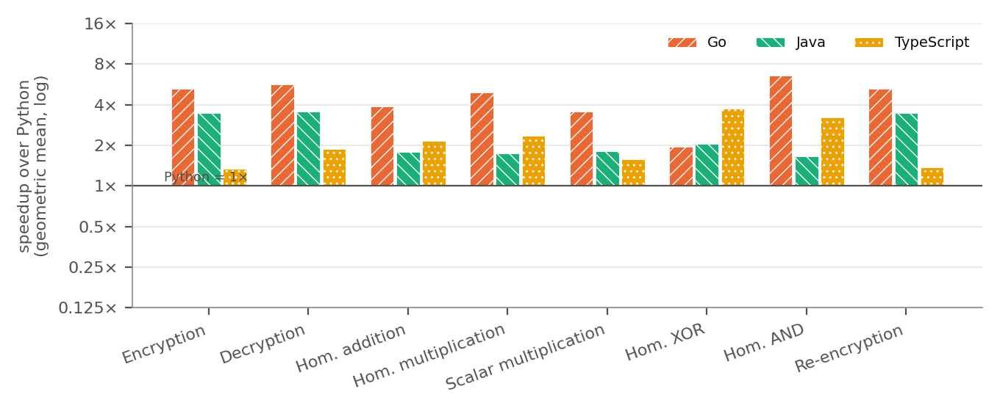


## Encryption

Median latency. `–` not supported by the scheme, `n/a` no parameter at that level or not run, `excl.` killed at the time limit, `fail` no key pair within `max_tries`, `(k fail)` k key generation attempts exhausted `max_tries`, `†` decryption of the result did not match.

| Scheme | 80-bit Python | 80-bit Go | 80-bit Java | 80-bit TypeScript | 112-bit Python | 112-bit Go | 112-bit Java | 112-bit TypeScript | 128-bit Python | 128-bit Go | 128-bit Java | 128-bit TypeScript |
|---|---|---|---|---|---|---|---|---|---|---|---|---|
| RSA | 3.78 ms | 734 µs | 648 µs | 3.50 ms | 25.1 ms | 4.43 ms | 4.72 ms | 18.6 ms | 58.7 ms | 10.7 ms | 11.6 ms | 40.3 ms |
| ElGamal | 1.50 ms | 285 µs | 170 µs | 1.38 ms | 9.16 ms | 1.46 ms | 1.22 ms | 6.58 ms | 20.1 ms | 3.17 ms | 3.05 ms | 13.8 ms |
| Exp-ElGamal | 1.41 ms | 278 µs | 209 µs | 1.55 ms | 8.98 ms | 1.55 ms | 1.35 ms | 6.80 ms | 20.4 ms | 3.24 ms | 3.05 ms | 13.7 ms |
| Paillier | 14.9 ms | 2.20 ms | 2.45 ms | 9.46 ms | 106 ms | 14.7 ms | 18.6 ms | 55.2 ms | 255 ms | 36.6 ms | 48.3 ms | 115 ms |
| Damgård-Jurik | 30.9 ms | 4.62 ms | 5.67 ms | 18.7 ms | 216 ms | 32.0 ms | 42.5 ms | 104 ms | 526 ms | 78.9 ms | 110 ms | 209 ms |
| Okamoto-Uchiyama | 13.5 ms | 2.07 ms | 1.98 ms | 8.99 ms | 91.5 ms | 13.7 ms | 15.6 ms | 52.6 ms | 230 ms | 32.7 ms | 40.5 ms | 110 ms |
| Goldwasser-Micali | 26.8 µs | 18.6 µs | 89.7 µs | 211 µs | 62.6 µs | 40.1 µs | 191 µs | 528 µs | 78.3 µs | 55.6 µs | 313 µs | 789 µs |
| Sander-Young-Yung | 2.25 ms | 2.78 ms | 9.81 ms | 23.1 ms | 7.10 ms | 4.65 ms | 33.8 ms | 88.6 ms | 7.36 ms | 5.04 ms | 47.8 ms | 119 ms |
| BGN | 192 ms | 25.8 ms | 142 ms | 257 ms | n/a | n/a | n/a | n/a | n/a | n/a | n/a | n/a |
| Joye-Libert | 1.14 ms | 275 µs | 239 µs | 808 µs | 6.96 ms | 1.38 ms | 1.28 ms | 3.76 ms | 15.4 ms | 3.03 ms | 2.98 ms | 7.42 ms |
| Castagnos-Laguillaumie | 735 ms | 415 ms | 621 ms | 982 ms | 3.49 s | 1.89 s | 3.22 s | 5.03 s | 9.01 s | 5.38 s | 7.25 s | 17.3 s |
| Ishai-Paskin | 31.3 ms | 4.68 ms | 5.69 ms | 18.4 ms | 218 ms | 32.0 ms | 43.2 ms | 106 ms | 723 ms | 108 ms | 149 ms | 281 ms |
| DGK | 1.87 ms | 253 µs | 231 µs | 1.41 ms | 6.63 ms | 990 µs | 1.10 ms | 3.95 ms | 13.2 ms | 2.05 ms | 2.21 ms | 6.97 ms |
| BCP | 65.4 ms | 9.34 ms | 10.1 ms | 40.2 ms | 444 ms | 60.1 ms | 71.6 ms | 213 ms | 1.02 s | 147 ms | 188 ms | 453 ms |
| Camenisch-Shoup | 30.3 ms | 4.38 ms | 4.73 ms | 18.8 ms | 212 ms | 29.9 ms | 36.4 ms | 108 ms | 512 ms | 73.5 ms | fail | 230 ms |
| EC-Paillier | 79.6 ms | 22.1 ms | 65.7 ms | 34.3 ms | 503 ms | 116 ms | 332 ms | 191 ms | 2.00 s | 437 ms | 1.13 s | 492 ms |
| EC-ElGamal (Weierstrass) | 8.68 ms | 2.31 ms | 5.78 ms | 17.4 ms | 23.7 ms | 5.37 ms | 15.8 ms | 36.9 ms | 31.8 ms | 6.75 ms | 21.4 ms | 47.2 ms |
| EC-ElGamal (Koblitz) | 812 ms | 365 ms | 139 ms | 402 ms | 2.22 s | 1.03 s | 369 ms | 1.15 s | 3.85 s | 1.86 s | 661 ms | 1.99 s |
| EC-ElGamal (Edwards) | n/a | n/a | n/a | n/a | 37.1 ms | 7.52 ms | 25.3 ms | 64.9 ms | 51.3 ms | 10.9 ms | 38.7 ms | 91.9 ms |
| Freeman-BGN | 232 ms | 34.3 ms | 148 ms | 20.0 ms | 526 ms | 71.3 ms | 410 ms | 46.3 ms | 996 ms | 118 ms | 780 ms | 80.7 ms |
| Regev | 41.9 ms | 3.74 ms | 5.21 ms | 40.2 ms | 41.9 ms | 3.74 ms | 5.21 ms | 40.2 ms | 41.9 ms | 3.74 ms | 5.21 ms | 40.2 ms |
| LPR | 35.8 ms | 4.61 ms | 4.98 ms | 18.5 ms | 35.8 ms | 4.61 ms | 4.98 ms | 18.5 ms | 35.8 ms | 4.61 ms | 4.98 ms | 18.5 ms |
| GSW | 605 ms | 88.8 ms | 82.5 ms | 311 ms | 605 ms | 88.8 ms | 82.5 ms | 311 ms | 605 ms | 88.8 ms | 82.5 ms | 311 ms |
| BV | 199 ms | 36.3 ms | 56.0 ms | 56.6 ms | 199 ms | 36.3 ms | 56.0 ms | 56.6 ms | 199 ms | 36.3 ms | 56.0 ms | 56.6 ms |
| ML-KEM | 8.06 ms | 492 µs | 628 µs | 4.52 ms | 8.06 ms | 492 µs | 628 µs | 4.52 ms | 8.06 ms | 492 µs | 628 µs | 4.52 ms |


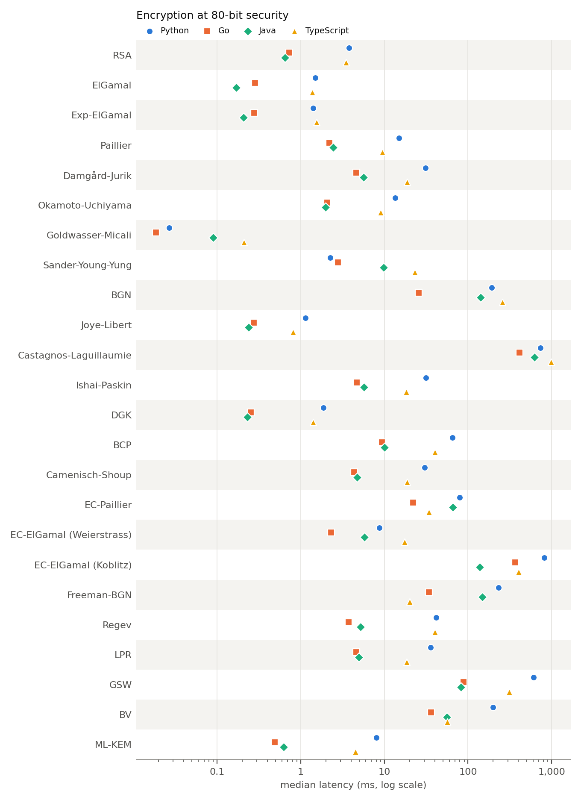


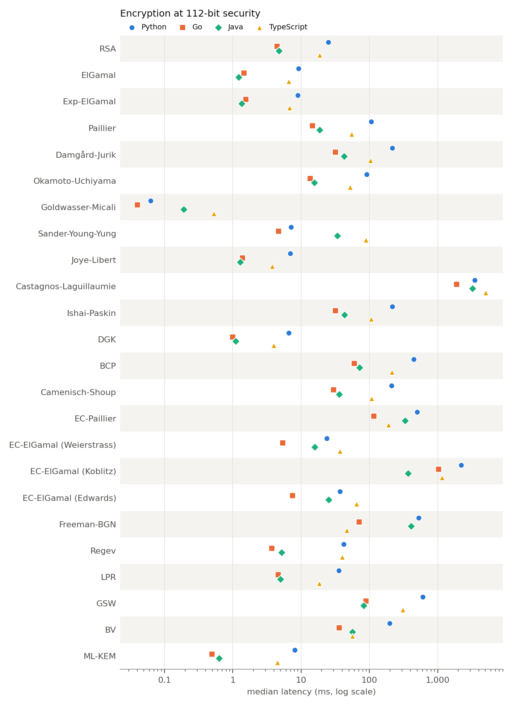


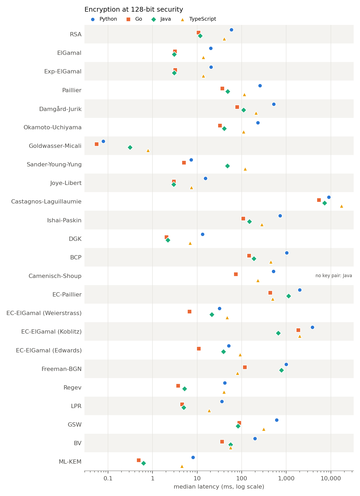


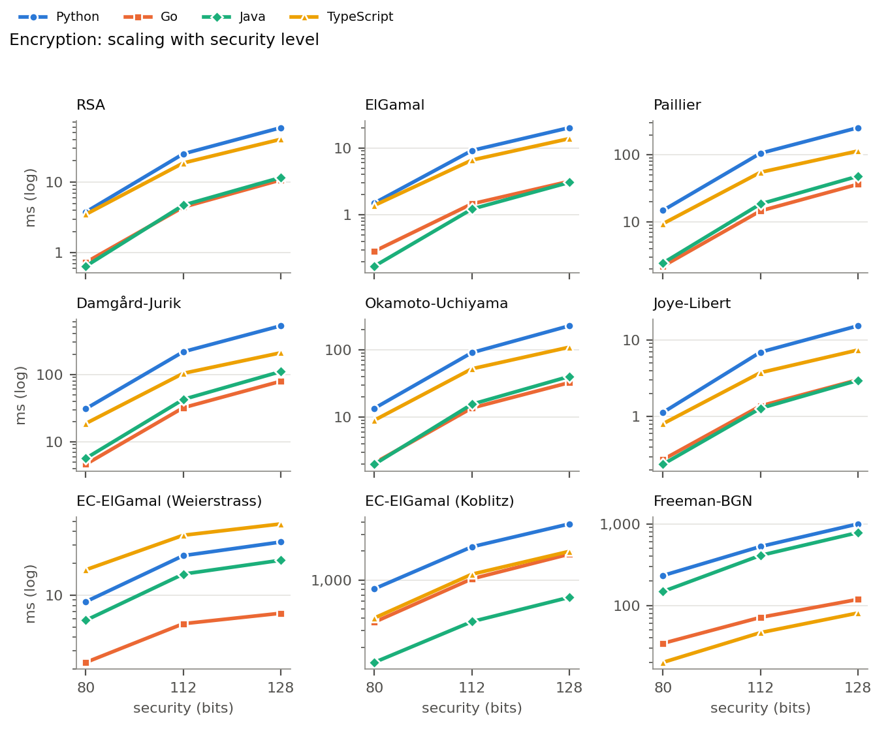


## Decryption

Median latency. `–` not supported by the scheme, `n/a` no parameter at that level or not run, `excl.` killed at the time limit, `fail` no key pair within `max_tries`, `(k fail)` k key generation attempts exhausted `max_tries`, `†` decryption of the result did not match.

| Scheme | 80-bit Python | 80-bit Go | 80-bit Java | 80-bit TypeScript | 112-bit Python | 112-bit Go | 112-bit Java | 112-bit TypeScript | 128-bit Python | 128-bit Go | 128-bit Java | 128-bit TypeScript |
|---|---|---|---|---|---|---|---|---|---|---|---|---|
| RSA | 4.71 ms | 752 µs | 649 µs | 3.32 ms | 30.5 ms | 4.55 ms | 4.74 ms | 18.2 ms | 71.7 ms | 10.8 ms | 11.7 ms | 39.8 ms |
| ElGamal | 791 µs | 144 µs | 163 µs | 810 µs | 4.76 ms | 741 µs | 792 µs | 3.51 ms | 10.3 ms | 1.62 ms | 1.70 ms | 7.22 ms |
| Exp-ElGamal | 823 µs | 149 µs | 182 µs | 956 µs | 4.83 ms | 771 µs | 864 µs | 3.90 ms | 11.0 ms | 1.64 ms | 1.91 ms | 7.39 ms |
| Paillier | 15.3 ms | 2.20 ms | 2.51 ms | 9.05 ms | 106 ms | 14.5 ms | 18.7 ms | 54.7 ms | 255 ms | 37.3 ms | 48.4 ms | 114 ms |
| Damgård-Jurik | 31.5 ms | 4.59 ms | 5.42 ms | 17.3 ms | 220 ms | 31.6 ms | 41.5 ms | 99.7 ms | 531 ms | 78.8 ms | 108 ms | 204 ms |
| Okamoto-Uchiyama | 4.60 ms | 390 µs | 795 µs | 3.77 ms | 30.8 ms | 2.33 ms | 5.30 ms | 19.6 ms | 72.6 ms | 5.49 ms | 12.9 ms | 42.5 ms |
| Goldwasser-Micali | 884 µs | 279 µs | 108 µs | 746 µs | 4.74 ms | 1.44 ms | 615 µs | 3.19 ms | 10.0 ms | 3.15 ms | 1.53 ms | 6.82 ms |
| Sander-Young-Yung | 54.9 ms | 16.0 ms | 45.4 ms | 25.3 ms | 230 ms | 28.4 ms | 155 ms | 117 ms | 284 ms | 30.5 ms | 237 ms | 154 ms |
| BGN | 405 ms | 51.9 ms | 291 ms | 528 ms | n/a | n/a | n/a | n/a | n/a | n/a | n/a | n/a |
| Joye-Libert | 4.49 ms | 1.36 ms | 782 µs | 5.24 ms | 20.9 ms | 6.18 ms | 4.30 ms | 22.6 ms | 42.0 ms | 11.4 ms | 9.60 ms | 39.5 ms |
| Castagnos-Laguillaumie | 371 ms | 211 ms | 300 ms | 488 ms | 1.73 s | 933 ms | 1.60 s | 2.53 s | 4.44 s | 2.68 s | 3.63 s | 8.81 s |
| Ishai-Paskin | 32.0 ms | 4.70 ms | 5.48 ms | 17.4 ms | 223 ms | 32.1 ms | 42.3 ms | 101 ms | 732 ms | 107 ms | 147 ms | 269 ms |
| DGK | 671 µs | 39.1 µs | 150 µs | 603 µs | 2.17 ms | 139 µs | 417 µs | 1.40 ms | 3.96 ms | 277 µs | 754 µs | 2.35 ms |
| BCP | 33.0 ms | 4.72 ms | 5.47 ms | 20.9 ms | 222 ms | 29.7 ms | 37.3 ms | 112 ms | 514 ms | 74.1 ms | 96.4 ms | 231 ms |
| Camenisch-Shoup | 37.7 ms | 6.80 ms | 7.49 ms | 23.7 ms | 272 ms | 44.3 ms | 55.6 ms | 138 ms | 640 ms | 111 ms | fail | 284 ms |
| EC-Paillier | 204 ms | 57.8 ms | 177 ms | 88.2 ms | 1.37 s | 321 ms | 928 ms | 526 ms | 5.72 s | 1.23 s | 2.71 s | 1.41 s |
| EC-ElGamal (Weierstrass) | 5.28 ms | 1.19 ms | 2.96 ms | 9.92 ms | 14.1 ms | 2.94 ms | 8.29 ms | 18.6 ms | 18.4 ms | 3.44 ms | 10.7 ms | 24.2 ms |
| EC-ElGamal (Koblitz) | 511 ms | 190 ms | 74.9 ms | 220 ms | 1.32 s | 540 ms | 196 ms | 591 ms | 2.26 s | 962 ms | 344 ms | 1.00 s |
| EC-ElGamal (Edwards) | n/a | n/a | n/a | n/a | 22.2 ms | 4.20 ms | 13.4 ms | 33.4 ms | 28.9 ms | 5.91 ms | 19.6 ms | 49.3 ms |
| Freeman-BGN | 191 ms | 30.0 ms | 120 ms | 110 ms | 438 ms | 62.8 ms | 330 ms | 256 ms | 810 ms | 105 ms | 647 ms | 427 ms |
| Regev | 221 µs | 11.9 µs | 46.7 µs | 32.2 µs | 221 µs | 11.9 µs | 46.7 µs | 32.2 µs | 221 µs | 11.9 µs | 46.7 µs | 32.2 µs |
| LPR | 414 µs | 11.9 µs | 56.6 µs | 58.9 µs | 414 µs | 11.9 µs | 56.6 µs | 58.9 µs | 414 µs | 11.9 µs | 56.6 µs | 58.9 µs |
| GSW | 392 µs | 306 µs | 754 µs | 55.0 µs | 392 µs | 306 µs | 754 µs | 55.0 µs | 392 µs | 306 µs | 754 µs | 55.0 µs |
| BV | 659 µs | 361 µs | 234 µs | 209 µs | 659 µs | 361 µs | 234 µs | 209 µs | 659 µs | 361 µs | 234 µs | 209 µs |
| ML-KEM | 852 µs | 167 µs | 117 µs | 414 µs | 852 µs | 167 µs | 117 µs | 414 µs | 852 µs | 167 µs | 117 µs | 414 µs |


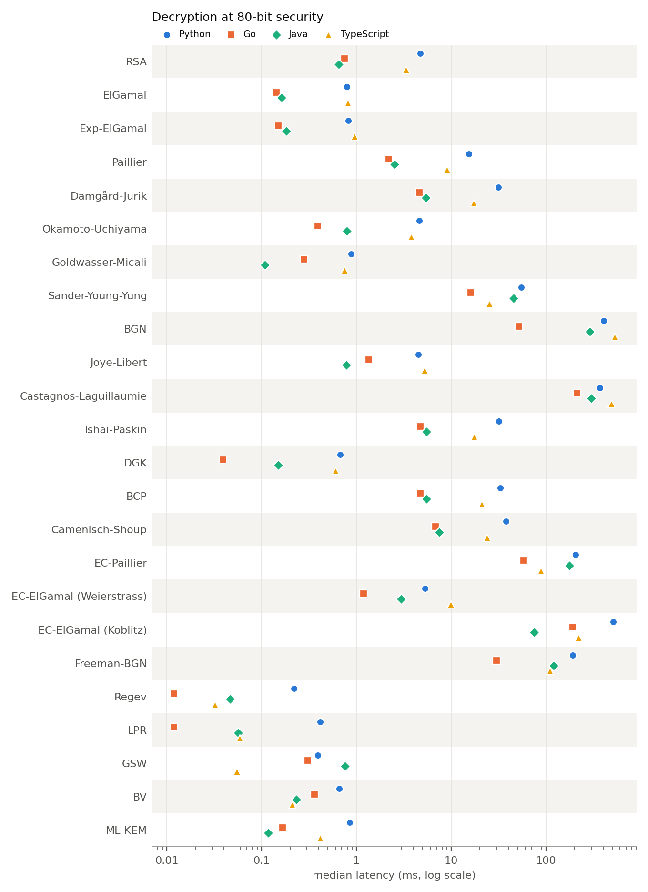


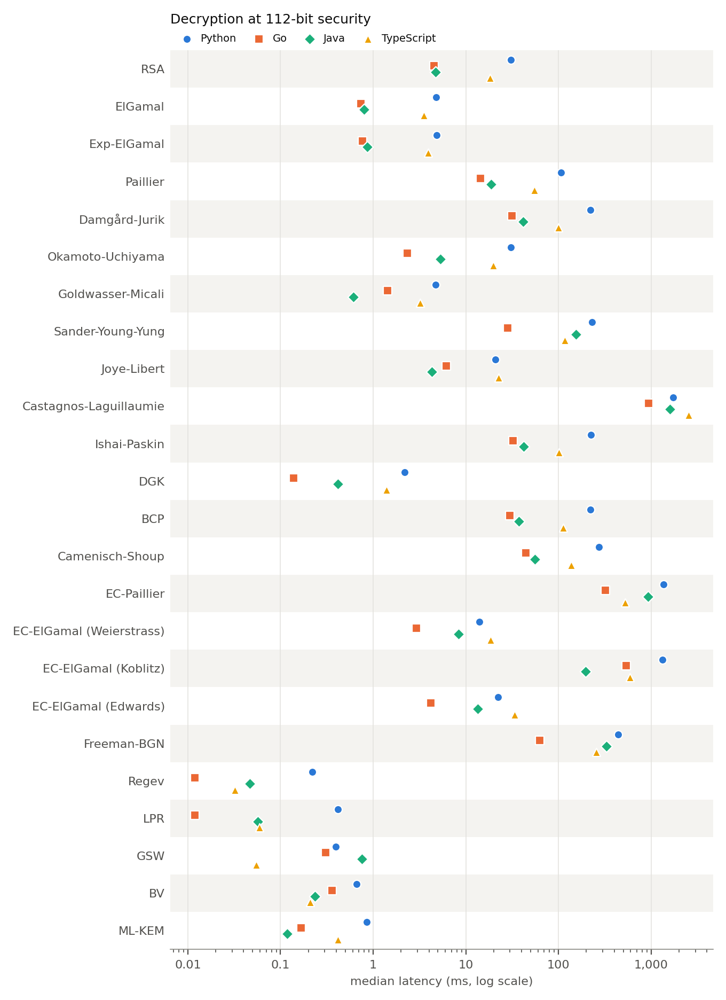


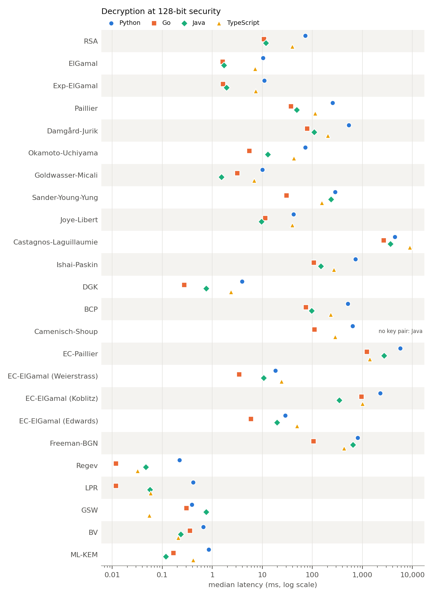


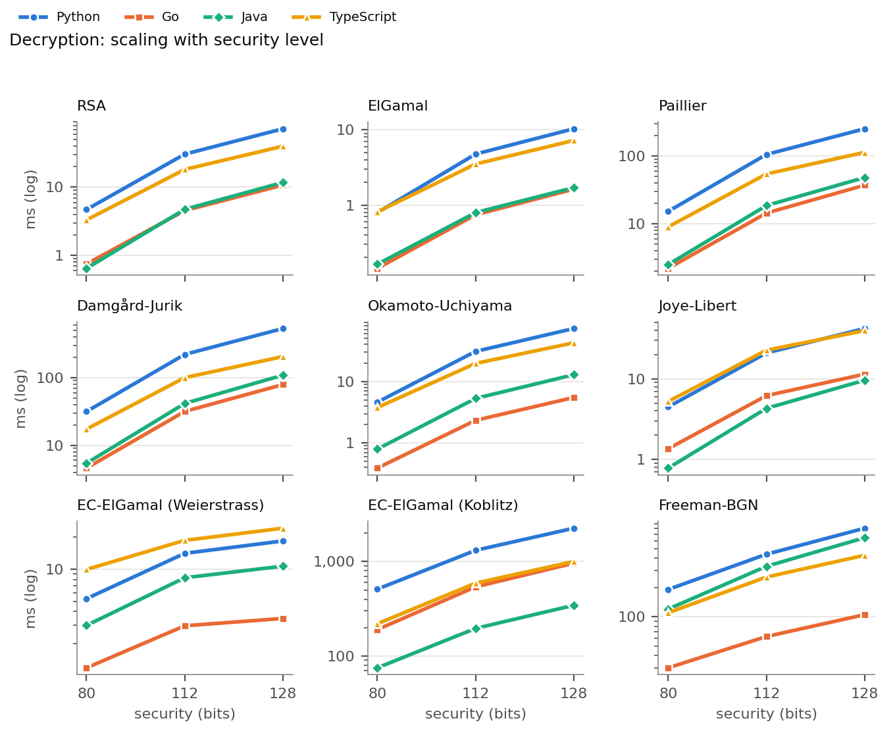


## Homomorphic addition

Median latency. `–` not supported by the scheme, `n/a` no parameter at that level or not run, `excl.` killed at the time limit, `fail` no key pair within `max_tries`, `(k fail)` k key generation attempts exhausted `max_tries`, `†` decryption of the result did not match.

| Scheme | 80-bit Python | 80-bit Go | 80-bit Java | 80-bit TypeScript | 112-bit Python | 112-bit Go | 112-bit Java | 112-bit TypeScript | 128-bit Python | 128-bit Go | 128-bit Java | 128-bit TypeScript |
|---|---|---|---|---|---|---|---|---|---|---|---|---|
| Exp-ElGamal | 3.18 µs | 1.54 µs | 2.34 µs | 2.06 µs | 9.47 µs | 2.85 µs | 6.97 µs | 4.36 µs | 13.4 µs | 3.65 µs | 13.4 µs | 5.80 µs |
| Paillier | 15.3 µs | 3.39 µs | 14.7 µs | 6.27 µs | 47.6 µs | 8.50 µs | 52.3 µs | 18.0 µs | 80.9 µs | 15.6 µs | 49.0 µs | 27.2 µs |
| Damgård-Jurik | 33.4 µs | 6.41 µs | 31.6 µs | 12.7 µs | 123 µs | 20.0 µs | 59.3 µs | 36.7 µs | 179 µs | 29.2 µs | 103 µs | 47.6 µs |
| Okamoto-Uchiyama | 9.56 µs | 2.31 µs | 7.82 µs | 4.04 µs | 27.7 µs | 6.51 µs | 30.7 µs | 12.0 µs | 44.2 µs | 10.3 µs | 30.8 µs | 15.3 µs |
| BGN | 247 µs | 39.0 µs | 179 µs | 323 µs | n/a | n/a | n/a | n/a | n/a | n/a | n/a | n/a |
| Joye-Libert | 5.09 µs | 1.40 µs | 3.70 µs | 2.22 µs | 15.4 µs | 3.62 µs | 12.5 µs | 6.40 µs | 30.2 µs | 5.24 µs | 15.8 µs | 8.41 µs |
| Castagnos-Laguillaumie | 875 µs | 463 µs | 651 µs | 1.17 ms | 2.13 ms | 1.08 ms | 2.02 ms | 3.05 ms | 3.86 ms | 1.65 ms | 2.98 ms | 7.42 ms |
| Ishai-Paskin | 34.1 µs | 6.76 µs | 30.2 µs | 13.3 µs | 114 µs | 20.0 µs | 61.8 µs | 38.2 µs | 256 µs | 32.5 µs | 117 µs | 67.8 µs |
| DGK | 4.57 µs | 1.15 µs | 4.19 µs | 2.50 µs | 15.1 µs | 3.59 µs | 14.1 µs | 6.41 µs | 28.6 µs | 7.35 µs | 20.6 µs | 12.4 µs |
| BCP | 29.2 µs | 7.61 µs | 27.6 µs | 13.2 µs | 101 µs | 21.5 µs | 65.8 µs | 35.7 µs | 151 µs | 30.9 µs | 85.7 µs | 49.5 µs |
| Camenisch-Shoup | 29.3 µs | 7.26 µs | 25.7 µs | 12.1 µs | 99.3 µs | 22.2 µs | 67.9 µs | 35.5 µs | 156 µs | 31.4 µs | fail | 51.0 µs |
| EC-Paillier | 477 µs | 35.3 µs | 111 µs | 56.5 µs | 1.46 ms | 102 µs | 409 µs | 165 µs | 3.77 ms | 276 µs | 501 µs | 298 µs |
| EC-ElGamal (Weierstrass) | 50.3 µs | 14.3 µs | 23.6 µs | 73.3 µs | 95.8 µs | 22.3 µs | 41.3 µs | 107 µs | 104 µs | 24.4 µs | 52.1 µs | 116 µs |
| EC-ElGamal (Koblitz) | 5.54 ms | 1.75 ms | 805 µs | 1.84 ms | 9.63 ms | 3.46 ms | 1.29 ms | 3.54 ms | 12.7 ms | 4.43 ms | 2.07 ms | 4.34 ms |
| EC-ElGamal (Edwards) | n/a | n/a | n/a | n/a | 135 µs | 28.7 µs | 72.7 µs | 190 µs | 161 µs | 37.6 µs | 101 µs | 226 µs |
| Freeman-BGN | 363 µs | 59.0 µs | 202 µs | 389 µs | 807 µs | 119 µs | 575 µs | 903 µs | 1.51 ms | 188 µs | 1.11 ms | 1.47 ms |
| Regev | 352 µs | 136 µs | 89.8 µs | 79.3 µs | 352 µs | 136 µs | 89.8 µs | 79.3 µs | 352 µs | 136 µs | 89.8 µs | 79.3 µs |
| LPR | 344 µs | 139 µs | 103 µs | 79.7 µs | 344 µs | 139 µs | 103 µs | 79.7 µs | 344 µs | 139 µs | 103 µs | 79.7 µs |
| BV | 1.09 ms | 1.62 ms | 1.27 ms | 1.21 ms | 1.09 ms | 1.62 ms | 1.27 ms | 1.21 ms | 1.09 ms | 1.62 ms | 1.27 ms | 1.21 ms |


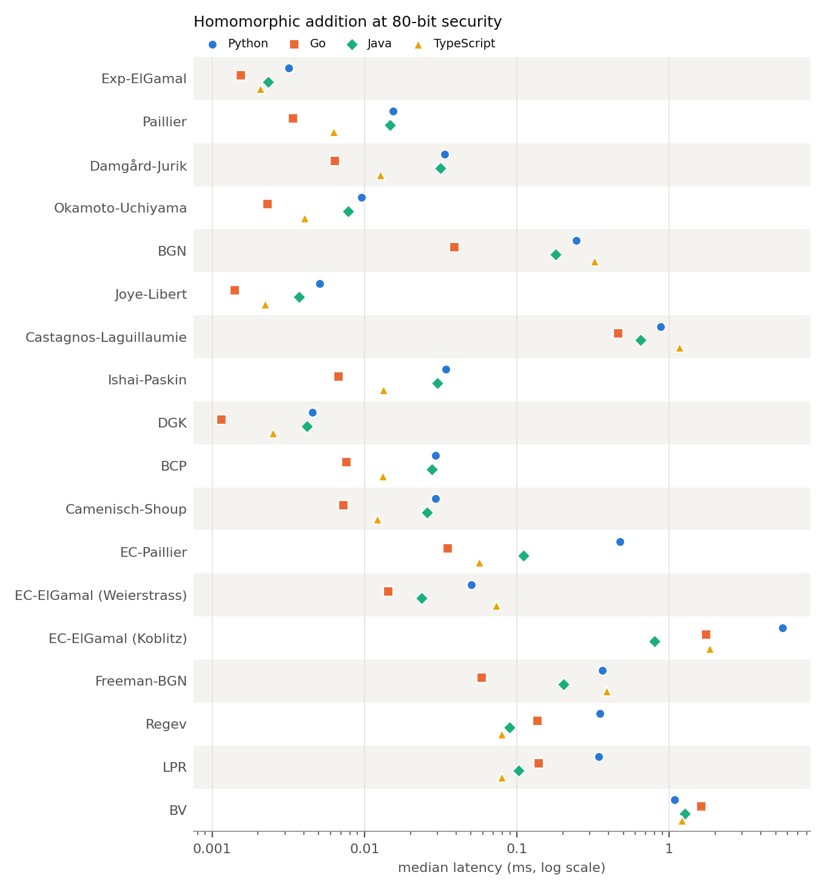


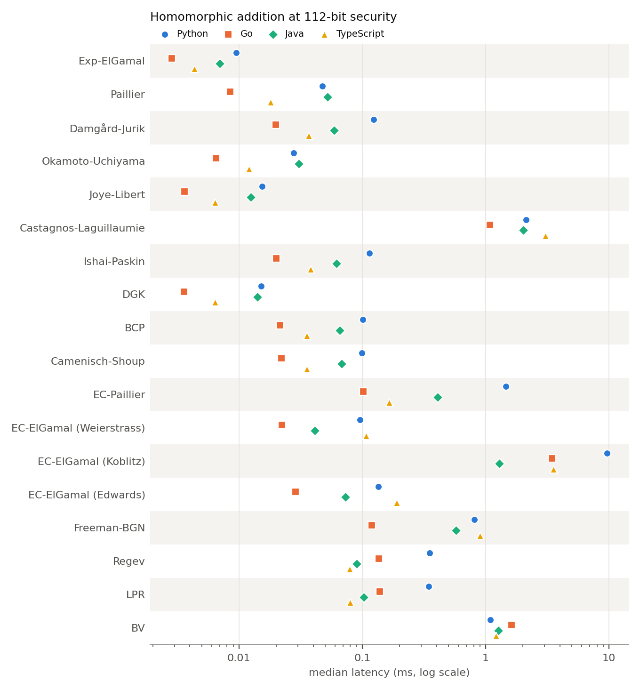


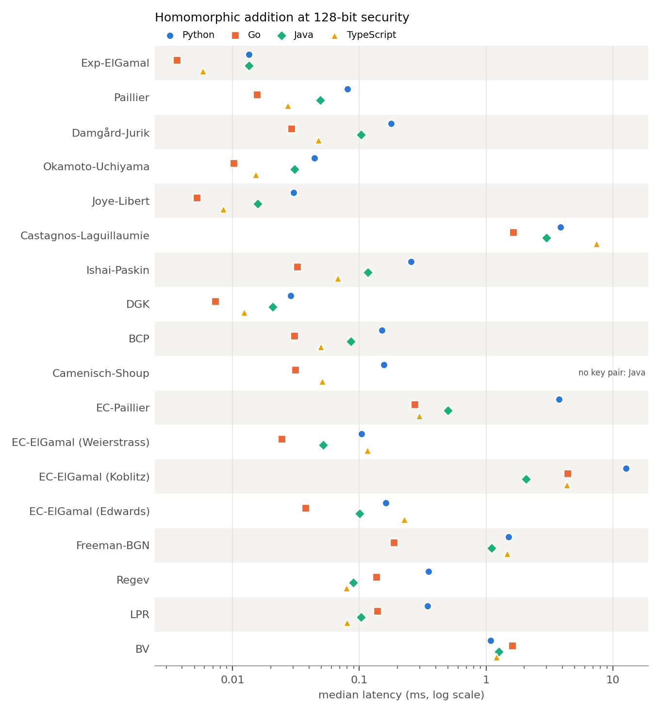


## Homomorphic multiplication

Median latency. `–` not supported by the scheme, `n/a` no parameter at that level or not run, `excl.` killed at the time limit, `fail` no key pair within `max_tries`, `(k fail)` k key generation attempts exhausted `max_tries`, `†` decryption of the result did not match.

| Scheme | 80-bit Python | 80-bit Go | 80-bit Java | 80-bit TypeScript | 112-bit Python | 112-bit Go | 112-bit Java | 112-bit TypeScript | 128-bit Python | 128-bit Go | 128-bit Java | 128-bit TypeScript |
|---|---|---|---|---|---|---|---|---|---|---|---|---|
| RSA | 5.00 µs | 1.44 µs | 4.03 µs | 2.31 µs | 15.3 µs | 3.91 µs | 12.8 µs | 5.35 µs | 21.4 µs | 4.83 µs | 15.8 µs | 8.50 µs |
| ElGamal | 2.64 µs | 2.28 µs | 2.64 µs | 1.72 µs | 9.38 µs | 2.84 µs | 7.82 µs | 4.29 µs | 12.6 µs | 3.73 µs | 11.7 µs | 5.91 µs |
| BGN | 1.57 s | 214 ms | 1.08 s | 2.07 s | n/a | n/a | n/a | n/a | n/a | n/a | n/a | n/a |
| Freeman-BGN | 1.32 s | 228 ms | 845 ms | 1.81 s | 3.42 s | 516 ms | 2.47 s | 4.45 s | 6.46 s | 874 ms | 4.77 s | 7.45 s |
| GSW | 1.54 s | 157 ms | 528 ms | 338 ms | 1.54 s | 157 ms | 528 ms | 338 ms | 1.54 s | 157 ms | 528 ms | 338 ms |
| BV | 233 ms | 55.5 ms | 80.6 ms | 37.5 ms | 233 ms | 55.5 ms | 80.6 ms | 37.5 ms | 233 ms | 55.5 ms | 80.6 ms | 37.5 ms |


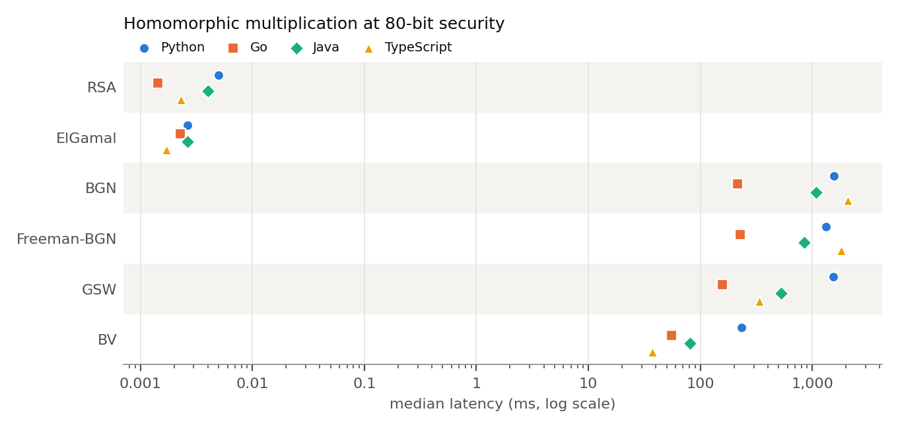


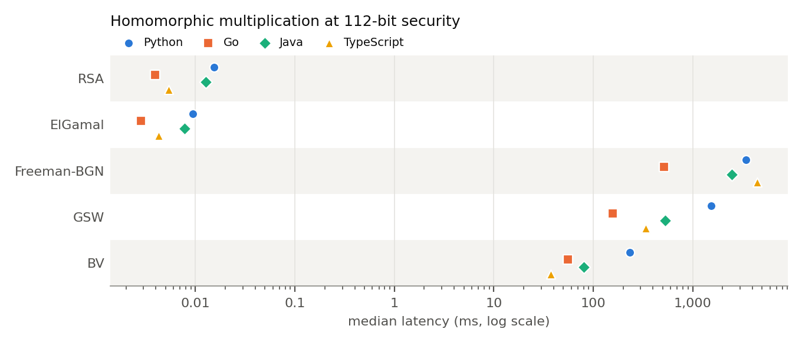


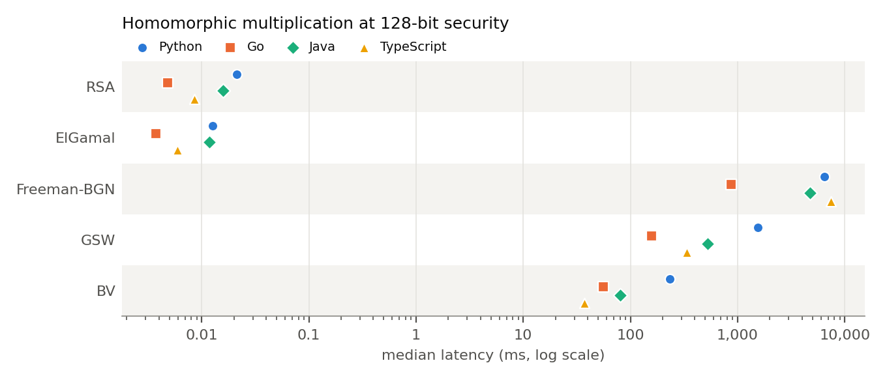


## Scalar multiplication

Median latency. `–` not supported by the scheme, `n/a` no parameter at that level or not run, `excl.` killed at the time limit, `fail` no key pair within `max_tries`, `(k fail)` k key generation attempts exhausted `max_tries`, `†` decryption of the result did not match.

| Scheme | 80-bit Python | 80-bit Go | 80-bit Java | 80-bit TypeScript | 112-bit Python | 112-bit Go | 112-bit Java | 112-bit TypeScript | 128-bit Python | 128-bit Go | 128-bit Java | 128-bit TypeScript |
|---|---|---|---|---|---|---|---|---|---|---|---|---|
| Exp-ElGamal | 6.59 µs | 2.57 µs | 5.05 µs | 6.28 µs | 18.0 µs | 5.33 µs | 10.7 µs | 12.8 µs | 25.3 µs | 7.24 µs | 20.2 µs | 17.3 µs |
| Paillier | 27.9 µs | 6.88 µs | 21.8 µs | 18.7 µs | 100 µs | 22.8 µs | 71.3 µs | 51.5 µs | 149 µs | 35.0 µs | 82.3 µs | 74.0 µs |
| Damgård-Jurik | 42.4 µs | 14.4 µs | 34.7 µs | 33.7 µs | 190 µs | 45.2 µs | 107 µs | 97.9 µs | 291 µs | 66.1 µs | 216 µs | 137 µs |
| Okamoto-Uchiyama | 17.5 µs | 4.73 µs | 13.4 µs | 11.8 µs | 54.1 µs | 14.4 µs | 43.8 µs | 35.3 µs | 86.0 µs | 21.9 µs | 50.8 µs | 47.2 µs |
| BGN | 539 µs | 69.0 µs | 308 µs | 670 µs | n/a | n/a | n/a | n/a | n/a | n/a | n/a | n/a |
| Joye-Libert | 9.03 µs | 2.87 µs | 5.51 µs | 6.71 µs | 28.8 µs | 7.12 µs | 19.4 µs | 18.8 µs | 43.1 µs | 13.5 µs | 25.4 µs | 36.0 µs |
| Castagnos-Laguillaumie | 2.66 ms | 925 µs | 2.09 ms | 3.62 ms | 6.67 ms | 2.38 ms | 6.10 ms | 9.35 ms | 10.9 ms | 3.30 ms | 9.02 ms | 22.2 ms |
| Ishai-Paskin | 53.4 µs | 15.4 µs | 34.4 µs | 36.3 µs | 166 µs | 46.4 µs | 110 µs | 100 µs | 403 µs | 93.1 µs | 240 µs | 175 µs |
| DGK | 8.82 µs | 2.32 µs | 5.83 µs | 7.28 µs | 29.0 µs | 7.14 µs | 20.8 µs | 19.2 µs | 57.4 µs | 20.9 µs | 32.8 µs | 35.2 µs |
| BCP | 60.2 µs | 16.5 µs | 40.3 µs | 39.7 µs | 192 µs | 46.9 µs | 113 µs | 104 µs | 283 µs | 70.8 µs | 208 µs | 148 µs |
| Camenisch-Shoup | 44.4 µs | 15.3 µs | 37.6 µs | 36.5 µs | 185 µs | 47.0 µs | 116 µs | 106 µs | 285 µs | 71.3 µs | fail | 151 µs |
| EC-Paillier | 533 µs | 81.2 µs | 250 µs | 126 µs | 1.69 ms | 230 µs | 681 µs | 496 µs | 4.60 ms | 604 µs | 1.10 ms | 668 µs |
| EC-ElGamal (Weierstrass) | 84.9 µs | 21.4 µs | 42.7 µs | 116 µs | 172 µs | 34.5 µs | 83.6 µs | 209 µs | 177 µs | 36.5 µs | 107 µs | 253 µs |
| EC-ElGamal (Koblitz) | 9.25 ms | 3.34 ms | 1.51 ms | 3.02 ms | 16.7 ms | 5.95 ms | 2.42 ms | 6.77 ms | 23.2 ms | 9.30 ms | 3.65 ms | 9.05 ms |
| EC-ElGamal (Edwards) | n/a | n/a | n/a | n/a | 259 µs | 48.6 µs | 144 µs | 403 µs | 312 µs | 61.0 µs | 204 µs | 475 µs |
| Freeman-BGN | 613 µs | 97.0 µs | 392 µs | 449 µs | 1.52 ms | 191 µs | 1.14 ms | 982 µs | 2.85 ms | 328 µs | 2.24 ms | 1.65 ms |
| Regev | 365 µs | 128 µs | 121 µs | 78.2 µs | 365 µs | 128 µs | 121 µs | 78.2 µs | 365 µs | 128 µs | 121 µs | 78.2 µs |
| LPR | 404 µs | 129 µs | 78.1 µs | 132 µs | 404 µs | 129 µs | 78.1 µs | 132 µs | 404 µs | 129 µs | 78.1 µs | 132 µs |
| BV | 1.14 ms | 1.71 ms | 1.37 ms | 1.64 ms | 1.14 ms | 1.71 ms | 1.37 ms | 1.64 ms | 1.14 ms | 1.71 ms | 1.37 ms | 1.64 ms |


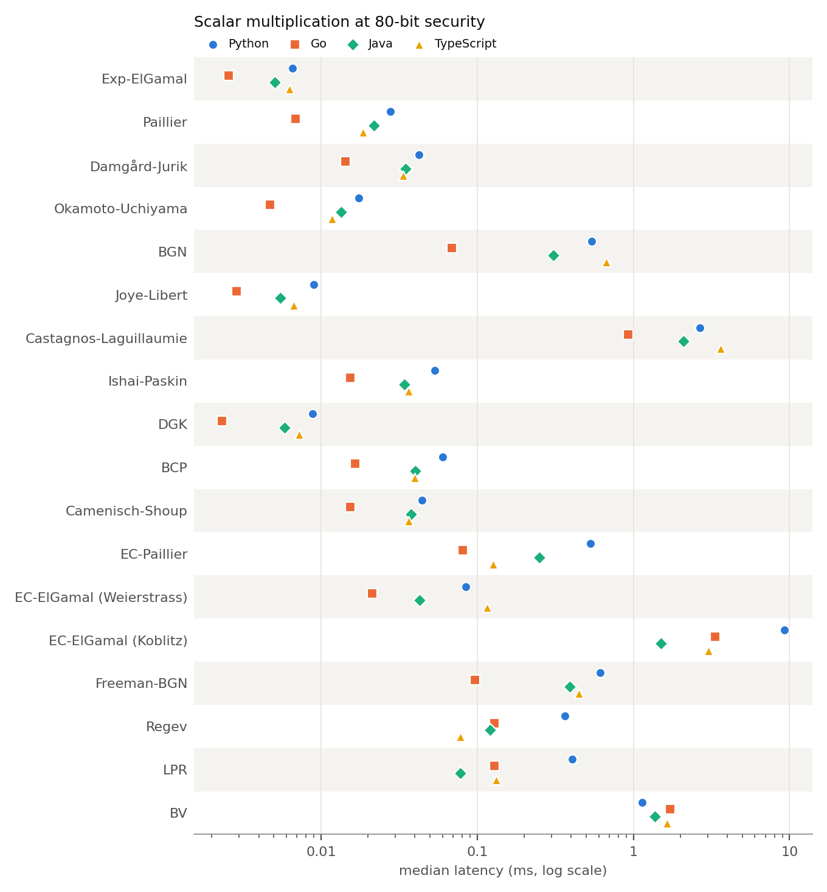


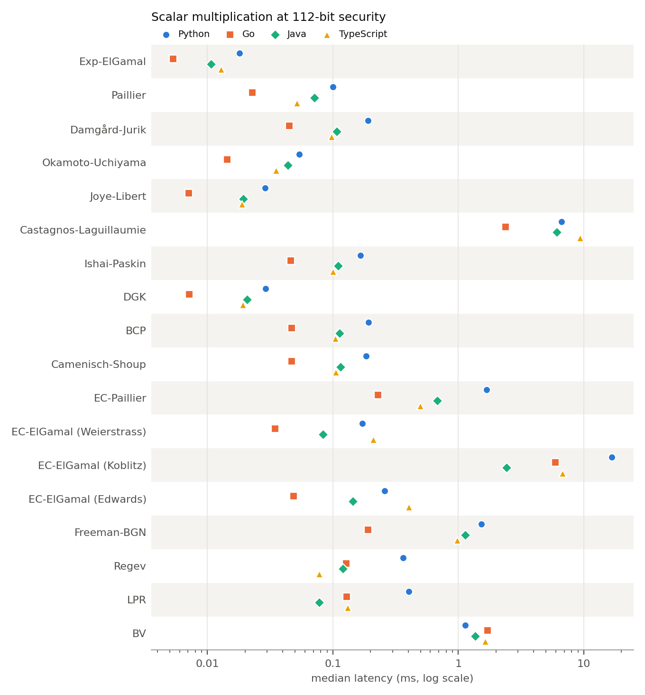


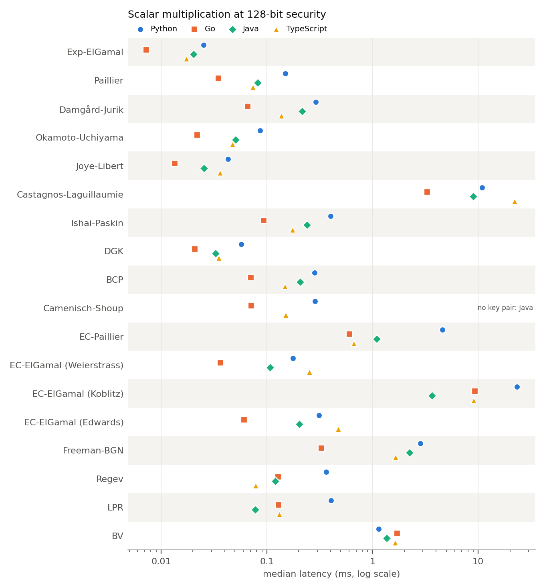


## Homomorphic XOR

Median latency. `–` not supported by the scheme, `n/a` no parameter at that level or not run, `excl.` killed at the time limit, `fail` no key pair within `max_tries`, `(k fail)` k key generation attempts exhausted `max_tries`, `†` decryption of the result did not match.

| Scheme | 80-bit Python | 80-bit Go | 80-bit Java | 80-bit TypeScript | 112-bit Python | 112-bit Go | 112-bit Java | 112-bit TypeScript | 128-bit Python | 128-bit Go | 128-bit Java | 128-bit TypeScript |
|---|---|---|---|---|---|---|---|---|---|---|---|---|
| Goldwasser-Micali | 5.46 µs | 1.51 µs | 4.48 µs | 2.24 µs | 12.5 µs | 2.84 µs | 17.2 µs | 6.17 µs | 22.3 µs | 5.21 µs | 17.2 µs | 8.85 µs |
| GSW | 7.55 ms | 4.22 ms | 2.90 ms | 1.26 ms | 7.55 ms | 4.22 ms | 2.90 ms | 1.26 ms | 7.55 ms | 4.22 ms | 2.90 ms | 1.26 ms |
| ML-KEM | 97.9 µs | 96.3 µs | 31.3 µs | 26.4 µs | 97.9 µs | 96.3 µs | 31.3 µs | 26.4 µs | 97.9 µs | 96.3 µs | 31.3 µs | 26.4 µs |


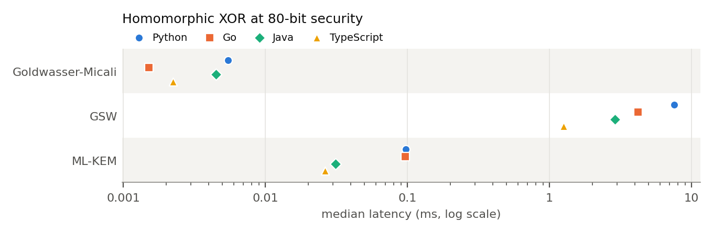


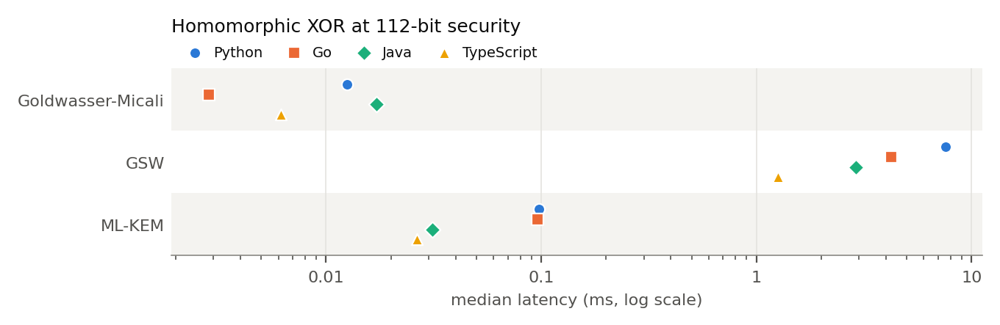


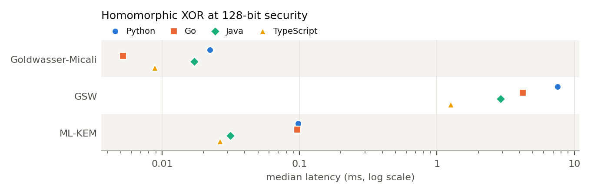


## Homomorphic AND

Median latency. `–` not supported by the scheme, `n/a` no parameter at that level or not run, `excl.` killed at the time limit, `fail` no key pair within `max_tries`, `(k fail)` k key generation attempts exhausted `max_tries`, `†` decryption of the result did not match.

| Scheme | 80-bit Python | 80-bit Go | 80-bit Java | 80-bit TypeScript | 112-bit Python | 112-bit Go | 112-bit Java | 112-bit TypeScript | 128-bit Python | 128-bit Go | 128-bit Java | 128-bit TypeScript |
|---|---|---|---|---|---|---|---|---|---|---|---|---|
| Sander-Young-Yung | 510 µs | 230 µs | 657 µs | 210 µs | 2.39 ms | 440 µs | 2.32 ms | 1.04 ms | 2.75 ms | 514 µs | 2.72 ms | 1.34 ms |
| GSW | 1.56 s | 143 ms | 534 ms | 337 ms | 1.56 s | 143 ms | 534 ms | 337 ms | 1.56 s | 143 ms | 534 ms | 337 ms |


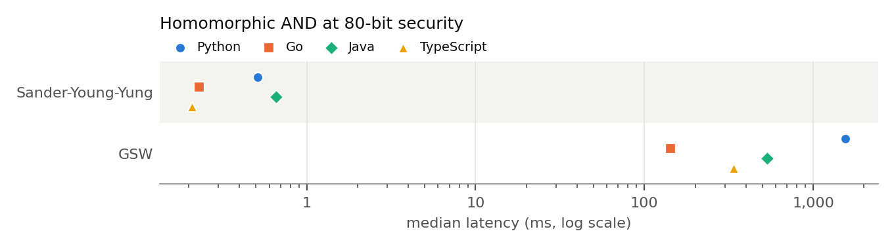


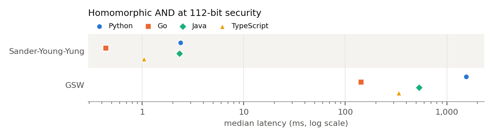


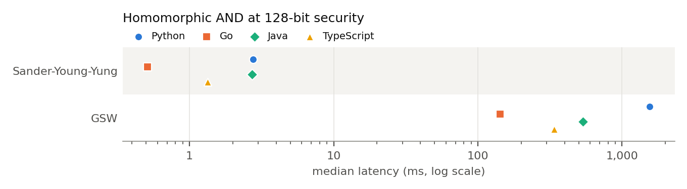


## Re-encryption

Median latency. `–` not supported by the scheme, `n/a` no parameter at that level or not run, `excl.` killed at the time limit, `fail` no key pair within `max_tries`, `(k fail)` k key generation attempts exhausted `max_tries`, `†` decryption of the result did not match.

| Scheme | 80-bit Python | 80-bit Go | 80-bit Java | 80-bit TypeScript | 112-bit Python | 112-bit Go | 112-bit Java | 112-bit TypeScript | 128-bit Python | 128-bit Go | 128-bit Java | 128-bit TypeScript |
|---|---|---|---|---|---|---|---|---|---|---|---|---|
| ElGamal | 1.56 ms | 282 µs | 213 µs | 1.40 ms | 9.23 ms | 1.44 ms | 1.30 ms | 6.64 ms | 20.0 ms | 3.21 ms | 3.04 ms | 13.8 ms |
| Exp-ElGamal | 1.38 ms | 277 µs | 224 µs | 1.51 ms | 9.04 ms | 1.43 ms | 1.25 ms | 6.93 ms | 20.8 ms | 3.18 ms | 3.14 ms | 13.8 ms |
| Paillier | 15.0 ms | 2.18 ms | 2.44 ms | 9.73 ms | 107 ms | 14.8 ms | 19.3 ms | 55.2 ms | 253 ms | 36.9 ms | 47.9 ms | 115 ms |
| Damgård-Jurik | 31.6 ms | 4.76 ms | 5.62 ms | 18.6 ms | 219 ms | 31.8 ms | 42.2 ms | 104 ms | 526 ms | 79.1 ms | 111 ms | 209 ms |
| Okamoto-Uchiyama | 13.6 ms | 2.05 ms | 1.96 ms | 8.82 ms | 91.9 ms | 13.9 ms | 15.1 ms | 52.9 ms | 225 ms | 32.6 ms | 40.1 ms | 110 ms |
| Goldwasser-Micali | 24.5 µs | 19.4 µs | 68.1 µs | 208 µs | 60.7 µs | 33.2 µs | 221 µs | 506 µs | 77.2 µs | 54.2 µs | 300 µs | 797 µs |
| Sander-Young-Yung | 2.77 ms | 3.07 ms | 10.2 ms | 23.3 ms | 10.5 ms | 5.09 ms | 36.0 ms | 88.5 ms | 11.4 ms | 5.75 ms | 51.1 ms | 123 ms |
| BGN | 193 ms | 25.9 ms | 141 ms | 255 ms | n/a | n/a | n/a | n/a | n/a | n/a | n/a | n/a |
| Joye-Libert | 1.12 ms | 233 µs | 224 µs | 796 µs | 6.89 ms | 1.40 ms | 1.34 ms | 3.71 ms | 20.5 ms | 2.98 ms | 2.94 ms | 7.45 ms |
| Castagnos-Laguillaumie | 726 ms | 416 ms | 584 ms | 983 ms | 3.49 s | 1.91 s | 3.20 s | 5.09 s | 8.93 s | 3.92 s | 7.17 s | 17.4 s |
| Ishai-Paskin | 31.4 ms | 4.70 ms | 5.78 ms | 18.2 ms | 218 ms | 32.1 ms | 42.8 ms | 105 ms | 729 ms | 108 ms | 149 ms | 282 ms |
| DGK | 1.84 ms | 249 µs | 278 µs | 1.37 ms | 6.53 ms | 1.02 ms | 1.06 ms | 3.88 ms | 12.7 ms | 2.04 ms | 2.06 ms | 6.87 ms |
| BCP | 65.4 ms | 9.29 ms | 10.2 ms | 40.5 ms | 441 ms | 59.4 ms | 71.7 ms | 217 ms | 1.01 s | 146 ms | 190 ms | 453 ms |
| Camenisch-Shoup | 30.3 ms | 4.55 ms | 4.81 ms | 19.1 ms | 218 ms | 29.6 ms | 37.2 ms | 108 ms | 510 ms | 73.4 ms | fail | 232 ms |
| EC-Paillier | 80.5 ms | 22.0 ms | 66.6 ms | 34.3 ms | 493 ms | 116 ms | 332 ms | 191 ms | 2.07 s | 435 ms | 807 ms | 495 ms |
| EC-ElGamal (Weierstrass) | 10.8 ms | 2.29 ms | 5.61 ms | 17.7 ms | 23.0 ms | 5.32 ms | 15.9 ms | 36.3 ms | 30.6 ms | 6.79 ms | 21.4 ms | 47.4 ms |
| EC-ElGamal (Koblitz) | 811 ms | 358 ms | 135 ms | 393 ms | 2.26 s | 1.02 s | 367 ms | 1.12 s | 3.92 s | 1.82 s | 662 ms | 1.99 s |
| EC-ElGamal (Edwards) | n/a | n/a | n/a | n/a | 37.2 ms | 7.50 ms | 24.9 ms | 64.4 ms | 51.1 ms | 10.8 ms | 38.6 ms | 92.1 ms |
| Freeman-BGN | 213 ms | 34.5 ms | 146 ms | 19.2 ms | 527 ms | 72.4 ms | 412 ms | 44.2 ms | 967 ms | 119 ms | 770 ms | 78.6 ms |
| Regev | 42.3 ms | 3.89 ms | 5.17 ms | 40.4 ms | 42.3 ms | 3.89 ms | 5.17 ms | 40.4 ms | 42.3 ms | 3.89 ms | 5.17 ms | 40.4 ms |
| LPR | 36.0 ms | 4.70 ms | 4.67 ms | 18.7 ms | 36.0 ms | 4.70 ms | 4.67 ms | 18.7 ms | 36.0 ms | 4.70 ms | 4.67 ms | 18.7 ms |
| GSW | 608 ms | 92.9 ms | 84.5 ms | 312 ms | 608 ms | 92.9 ms | 84.5 ms | 312 ms | 608 ms | 92.9 ms | 84.5 ms | 312 ms |
| BV | 201 ms | 38.1 ms | 57.9 ms | 59.1 ms | 201 ms | 38.1 ms | 57.9 ms | 59.1 ms | 201 ms | 38.1 ms | 57.9 ms | 59.1 ms |
| ML-KEM | 7.99 ms | 589 µs | 552 µs | 4.40 ms | 7.99 ms | 589 µs | 552 µs | 4.40 ms | 7.99 ms | 589 µs | 552 µs | 4.40 ms |


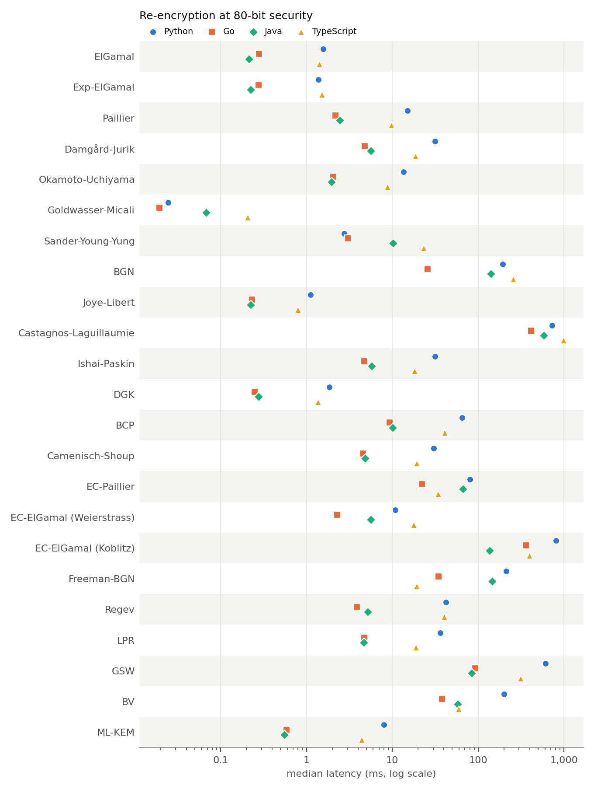


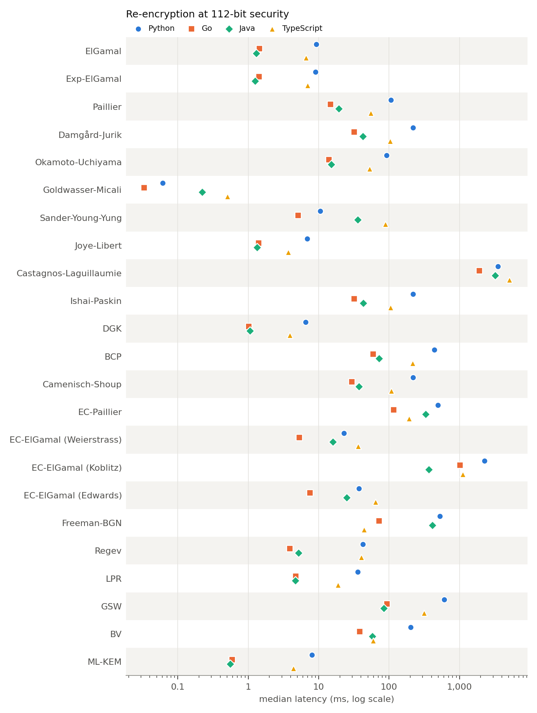


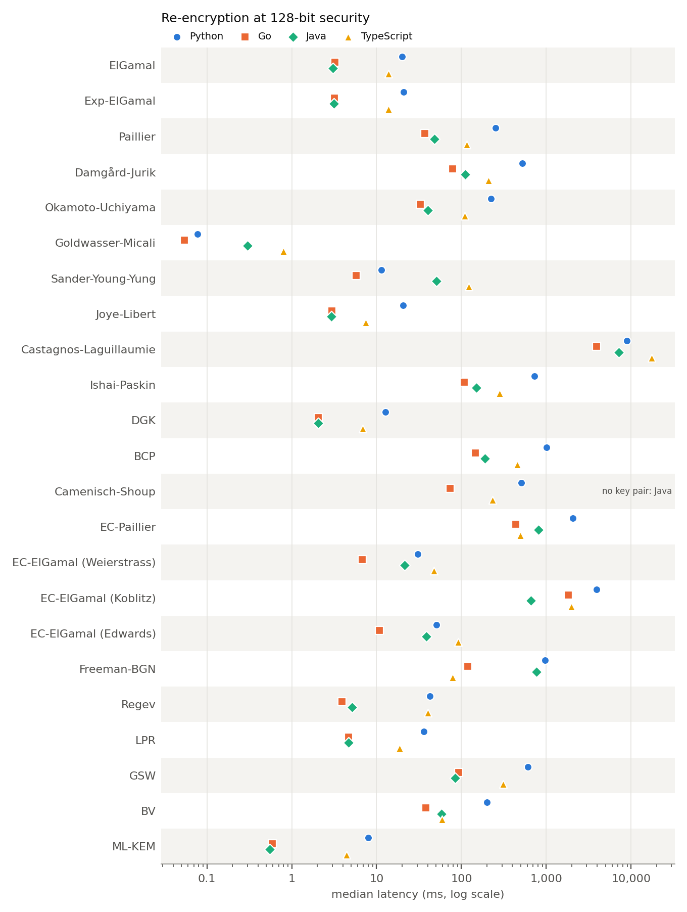


## Key generation (not a performance indicator)

> **⚠ Key generation times are not an indicator of language or implementation performance.**
> Most schemes generate keys by randomized search: they draw random candidates until one is
> prime, or until the primes satisfy extra conditions (safe primes, a block size r dividing
> p - 1, and so on). The number of draws is a random variable, so the same implementation in the same
> language can finish quickly on a lucky draw or take far longer on an unlucky one. For example,
> Benaloh draws primes until r (about 1,000-2,000) divides p - 1, which takes about r attempts on average
> with a geometric distribution, so one Benaloh key generation can take 1 s and the next 200 s
> in the same language. This run measured the same effect directly: Java needed between 0.17 s and
> 6.13 s (37x) for Joye-Libert-3072 keys across 9 draws, and several schemes vary 13-20x within
> one language. The ports also use different primality tests (sympy BPSW in Python, `crypto/rand.Prime`
> in Go, `isProbablePrime(40)` in Java, 40 Miller-Rabin rounds in TypeScript), and some differ in the
> search procedure itself. Key generation is also a one-time cost per key pair.
>
> The numbers below are reported for completeness, as median (min-max) over up to 10 fresh key
> pairs. They are left out of the speedup summary. `(k fail)` marks k attempts that exhausted
> `max_tries`.

| Scheme | 80-bit Python | 80-bit Go | 80-bit Java | 80-bit TypeScript | 112-bit Python | 112-bit Go | 112-bit Java | 112-bit TypeScript | 128-bit Python | 128-bit Go | 128-bit Java | 128-bit TypeScript |
|---|---|---|---|---|---|---|---|---|---|---|---|---|
| RSA | 7.20 ms (3.18 ms–14.6 ms) | 18.8 ms (11.0 ms–33.4 ms) | 20.7 ms (9.12 ms–31.2 ms) | 126 ms (110 ms–196 ms) | 60.3 ms (12.6 ms–97.6 ms) | 174 ms (68.0 ms–651 ms) | 77.9 ms (39.4 ms–214 ms) | 604 ms (376 ms–1.14 s) | 255 ms (46.1 ms–572 ms) | 390 ms (327 ms–854 ms) | 249 ms (85.9 ms–387 ms) | 1.72 s (815 ms–5.03 s) |
| ElGamal | 5.62 ms (1.65 ms–16.7 ms) | 8.39 ms (3.98 ms–25.9 ms) | 7.69 ms (5.57 ms–26.6 ms) | 67.7 ms (40.9 ms–113 ms) | 40.6 ms (13.6 ms–81.8 ms) | 59.9 ms (28.1 ms–291 ms) | 25.8 ms (15.0 ms–111 ms) | 285 ms (171 ms–1.20 s) | 110 ms (26.7 ms–359 ms) | 160 ms (44.2 ms–736 ms) | 73.2 ms (38.8 ms–328 ms) | 616 ms (450 ms–1.96 s) |
| Exp-ElGamal | 3.85 ms (1.86 ms–7.21 ms) | 6.10 ms (4.06 ms–16.7 ms) | 26.1 ms (18.4 ms–47.5 ms) | 57.2 ms (34.9 ms–81.3 ms) | 43.7 ms (15.1 ms–84.0 ms) | 43.8 ms (20.1 ms–151 ms) | 29.0 ms (18.9 ms–114 ms) | 272 ms (203 ms–872 ms) | 89.7 ms (28.9 ms–299 ms) | 233 ms (93.3 ms–911 ms) | 116 ms (34.0 ms–414 ms) | 952 ms (401 ms–2.83 s) |
| Paillier | 5.84 ms (2.69 ms–18.7 ms) | 20.5 ms (10.9 ms–27.6 ms) | 38.1 ms (18.1 ms–71.9 ms) | 131 ms (82.2 ms–210 ms) | 46.0 ms (16.3 ms–163 ms) | 209 ms (59.1 ms–519 ms) | 87.3 ms (44.4 ms–170 ms) | 777 ms (447 ms–1.49 s) | 263 ms (46.6 ms–350 ms) | 437 ms (160 ms–1.28 s) | 139 ms (68.8 ms–372 ms) | 1.53 s (1.21 s–3.70 s) |
| Damgård-Jurik | 8.20 ms (1.62 ms–11.9 ms) | 26.6 ms (11.9 ms–60.7 ms) | 28.2 ms (10.0 ms–61.0 ms) | 145 ms (94.6 ms–251 ms) | 57.7 ms (7.66 ms–108 ms) | 202 ms (83.8 ms–251 ms) | 57.1 ms (41.4 ms–148 ms) | 883 ms (509 ms–1.98 s) | 241 ms (62.7 ms–974 ms) | 914 ms (204 ms–1.22 s) | 234 ms (108 ms–601 ms) | 2.04 s (1.11 s–3.37 s) |
| Okamoto-Uchiyama | 21.6 ms (17.3 ms–29.0 ms) | 27.2 ms (12.0 ms–46.1 ms) | 19.2 ms (13.1 ms–45.0 ms) | 176 ms (122 ms–262 ms) | 167 ms (112 ms–290 ms) | 167 ms (82.2 ms–376 ms) | 99.4 ms (67.1 ms–152 ms) | 732 ms (601 ms–2.03 s) | 471 ms (364 ms–628 ms) | 475 ms (247 ms–1.02 s) | 243 ms (150 ms–478 ms) | 2.00 s (1.00 s–3.72 s) |
| Goldwasser-Micali | 9.41 ms (3.03 ms–17.3 ms) | 16.8 ms (9.41 ms–30.3 ms) | 35.1 ms (15.2 ms–60.4 ms) | 118 ms (88.4 ms–200 ms) | 60.2 ms (23.8 ms–182 ms) | 140 ms (59.1 ms–712 ms) | 69.9 ms (58.2 ms–114 ms) | 751 ms (403 ms–1.89 s) | 225 ms (64.3 ms–708 ms) | 458 ms (197 ms–1.09 s) | 230 ms (77.7 ms–559 ms) | 1.42 s (1.02 s–3.41 s) |
| Sander-Young-Yung | 4.11 ms (1.68 ms–12.7 ms) | 31.6 ms (9.49 ms–41.6 ms) | 44.3 ms (20.0 ms–60.6 ms) | 130 ms (89.6 ms–193 ms) | 99.9 ms (24.4 ms–125 ms) | 136 ms (59.1 ms–338 ms) | 69.2 ms (39.3 ms–110 ms) | 657 ms (413 ms–1.90 s) | 208 ms (104 ms–425 ms) | 359 ms (127 ms–810 ms) | 223 ms (158 ms–600 ms) | 1.76 s (927 ms–3.09 s) |
| BGN | 31.6 s (25.2 s–38.0 s) | 344 ms (327 ms–534 ms) | 210 s (26.5 s–394 s) | 236 s | n/a | n/a | n/a | n/a | n/a | n/a | n/a | n/a |
| Joye-Libert | 10.7 ms (3.61 ms–16.6 ms) | 45.9 ms (23.2 ms–73.0 ms) | 96.5 ms (20.9 ms–379 ms) | 86.0 ms (80.0 ms–151 ms) | 62.4 ms (24.6 ms–182 ms) | 244 ms (105 ms–425 ms) | 1.19 s (156 ms–3.09 s) | 788 ms (457 ms–1.07 s) | 223 ms (137 ms–425 ms) | 785 ms (279 ms–3.32 s) | 2.98 s (166 ms–6.13 s) | 2.08 s (1.39 s–4.21 s) |
| Castagnos-Laguillaumie | 563 ms (528 ms–677 ms) | 376 ms (320 ms–835 ms) | 544 ms (466 ms–670 ms) | 1.52 s (984 ms–3.06 s) | 3.29 s (2.69 s–4.07 s) | 2.10 s (1.36 s–6.12 s) | 3.17 s (2.41 s–3.84 s) | 9.77 s (7.26 s–15.9 s) | 8.41 s (6.63 s–15.9 s) | 14.2 s (3.98 s–18.9 s) | 6.56 s (5.68 s–12.9 s) | 45.3 s (22.2 s–68.4 s) |
| Ishai-Paskin | 7.40 ms (3.05 ms–9.97 ms) | 22.4 ms (8.63 ms–32.7 ms) | 33.6 ms (22.2 ms–47.1 ms) | 120 ms (97.7 ms–229 ms) | 86.9 ms (37.5 ms–134 ms) | 152 ms (79.0 ms–311 ms) | 69.2 ms (40.3 ms–133 ms) | 658 ms (368 ms–1.14 s) | 274 ms (129 ms–1.04 s) | 669 ms (328 ms–2.15 s) | 193 ms (96.6 ms–396 ms) | 2.32 s (1.33 s–4.23 s) |
| DGK | 8.99 ms (7.49 ms–21.1 ms) | 36.3 ms (27.8 ms–52.9 ms) | 47.3 ms (17.4 ms–136 ms) | 142 ms (115 ms–345 ms) | 89.5 ms (42.7 ms–150 ms) | 280 ms (116 ms–401 ms) | 623 ms (94.4 ms–988 ms) | 629 ms (489 ms–1.12 s) | 325 ms (110 ms–723 ms) | 603 ms (389 ms–1.04 s) | 2.46 s (1.22 s–6.35 s) | 2.53 s (1.54 s–4.46 s) |
| BCP | 464 ms (91.2 ms–1.73 s) | 673 ms (323 ms–1.48 s) | 1.21 s (557 ms–2.20 s) | 2.75 s (1.45 s–6.79 s) | 4.84 s (1.45 s–16.3 s) (1 fail) | 10.6 s (2.82 s–13.3 s) | 10.3 s (1.66 s–14.0 s) | 60.6 s (20.0 s–101 s) | 10.2 s (2 fail) | 39.6 s (37.3 s–41.9 s) | 17.7 s (2.15 s–33.3 s) (1 fail) | 65.1 s |
| Camenisch-Shoup | 1.29 s (461 ms–1.93 s) | 1.42 s (223 ms–2.90 s) | 1.39 s (342 ms–2.61 s) | 6.64 s (4.38 s–9.58 s) | 18.2 s (16.5 s–24.6 s) | 11.7 s (9.40 s–20.0 s) | 12.8 s (6.59 s–29.3 s) | 56.4 s (53.9 s–59.0 s) | 35.2 s (34.1 s–36.3 s) | 33.6 s (26.7 s–40.5 s) | fail | 362 s |
| EC-Paillier | 267 ms (258 ms–280 ms) | 86.1 ms (73.6 ms–115 ms) | 195 ms (173 ms–238 ms) | 182 ms (158 ms–225 ms) | 1.41 s (1.34 s–1.57 s) | 473 ms (431 ms–732 ms) | 1.15 s (1.05 s–1.57 s) | 1.16 s (933 ms–1.49 s) | 4.57 s (4.25 s–5.91 s) | 2.38 s (1.60 s–2.88 s) | 4.67 s (3.34 s–10.0 s) | 2.91 s (2.17 s–5.32 s) |
| EC-ElGamal (Weierstrass) | 8.28 ms (8.00 ms–8.41 ms) | 4.40 ms (4.11 ms–5.99 ms) | 16.7 ms (14.2 ms–19.1 ms) | 12.8 ms (12.0 ms–13.1 ms) | 27.8 ms (26.9 ms–28.5 ms) | 12.3 ms (11.9 ms–12.6 ms) | 58.0 ms (34.2 ms–63.3 ms) | 40.8 ms (38.6 ms–42.3 ms) | 31.7 ms (27.1 ms–33.6 ms) | 14.3 ms (13.9 ms–14.9 ms) | 48.6 ms (42.0 ms–90.3 ms) | 51.8 ms (48.6 ms–54.4 ms) |
| EC-ElGamal (Koblitz) | 743 ms (728 ms–782 ms) | 628 ms (609 ms–646 ms) | 182 ms (169 ms–202 ms) | 382 ms (357 ms–387 ms) | 2.06 s (2.03 s–2.10 s) | 1.85 s (1.83 s–1.89 s) | 501 ms (484 ms–547 ms) | 1.08 s (1.05 s–1.12 s) | 4.22 s (4.15 s–4.27 s) | 4.16 s (4.12 s–4.19 s) | 1.10 s (1.07 s–1.16 s) | 2.23 s (2.21 s–2.25 s) |
| EC-ElGamal (Edwards) | n/a | n/a | n/a | n/a | 40.5 ms (39.4 ms–42.3 ms) | 17.9 ms (17.0 ms–18.2 ms) | 47.2 ms (43.7 ms–93.1 ms) | 69.9 ms (61.6 ms–70.8 ms) | 48.3 ms (41.2 ms–50.8 ms) | 19.2 ms (18.2 ms–19.7 ms) | 63.2 ms (57.6 ms–104 ms) | 86.1 ms (83.9 ms–90.1 ms) |
| Freeman-BGN | 461 ms (443 ms–478 ms) | 87.6 ms (82.1 ms–93.6 ms) | 320 ms (305 ms–371 ms) | 256 ms (233 ms–278 ms) | 1.20 s (1.17 s–1.27 s) | 248 ms (208 ms–322 ms) | 1.05 s (911 ms–1.21 s) | 971 ms (734 ms–1.41 s) | 2.51 s (2.42 s–2.56 s) | 687 ms (521 ms–940 ms) | 2.40 s (1.89 s–4.88 s) | 2.33 s (1.58 s–3.06 s) |
| Regev | 495 ms (491 ms–509 ms) | 1.40 s (1.39 s–1.42 s) | 899 ms (737 ms–915 ms) | 2.83 s (2.79 s–2.87 s) | 495 ms (491 ms–509 ms) | 1.40 s (1.39 s–1.42 s) | 899 ms (737 ms–915 ms) | 2.83 s (2.79 s–2.87 s) | 495 ms (491 ms–509 ms) | 1.40 s (1.39 s–1.42 s) | 899 ms (737 ms–915 ms) | 2.83 s (2.79 s–2.87 s) |
| LPR | 37.3 ms (32.4 ms–47.7 ms) | 5.20 ms (5.04 ms–5.30 ms) | 6.92 ms (6.57 ms–34.8 ms) | 24.2 ms (20.3 ms–26.0 ms) | 37.3 ms (32.4 ms–47.7 ms) | 5.20 ms (5.04 ms–5.30 ms) | 6.92 ms (6.57 ms–34.8 ms) | 24.2 ms (20.3 ms–26.0 ms) | 37.3 ms (32.4 ms–47.7 ms) | 5.20 ms (5.04 ms–5.30 ms) | 6.92 ms (6.57 ms–34.8 ms) | 24.2 ms (20.3 ms–26.0 ms) |
| GSW | 37.2 ms (36.8 ms–39.9 ms) | 5.18 ms (5.06 ms–5.81 ms) | 9.35 ms (7.52 ms–29.6 ms) | 21.9 ms (20.7 ms–25.0 ms) | 37.2 ms (36.8 ms–39.9 ms) | 5.18 ms (5.06 ms–5.81 ms) | 9.35 ms (7.52 ms–29.6 ms) | 21.9 ms (20.7 ms–25.0 ms) | 37.2 ms (36.8 ms–39.9 ms) | 5.18 ms (5.06 ms–5.81 ms) | 9.35 ms (7.52 ms–29.6 ms) | 21.9 ms (20.7 ms–25.0 ms) |
| BV | 110 ms (108 ms–120 ms) | 23.1 ms (22.6 ms–53.7 ms) | 74.2 ms (35.6 ms–99.2 ms) | 46.8 ms (45.4 ms–56.5 ms) | 110 ms (108 ms–120 ms) | 23.1 ms (22.6 ms–53.7 ms) | 74.2 ms (35.6 ms–99.2 ms) | 46.8 ms (45.4 ms–56.5 ms) | 110 ms (108 ms–120 ms) | 23.1 ms (22.6 ms–53.7 ms) | 74.2 ms (35.6 ms–99.2 ms) | 46.8 ms (45.4 ms–56.5 ms) |
| ML-KEM | 7.85 ms (7.58 ms–8.04 ms) | 503 µs (493 µs–517 µs) | 3.25 ms (1.77 ms–8.15 ms) | 5.57 ms (3.85 ms–9.99 ms) | 7.85 ms (7.58 ms–8.04 ms) | 503 µs (493 µs–517 µs) | 3.25 ms (1.77 ms–8.15 ms) | 5.57 ms (3.85 ms–9.99 ms) | 7.85 ms (7.58 ms–8.04 ms) | 503 µs (493 µs–517 µs) | 3.25 ms (1.77 ms–8.15 ms) | 5.57 ms (3.85 ms–9.99 ms) |


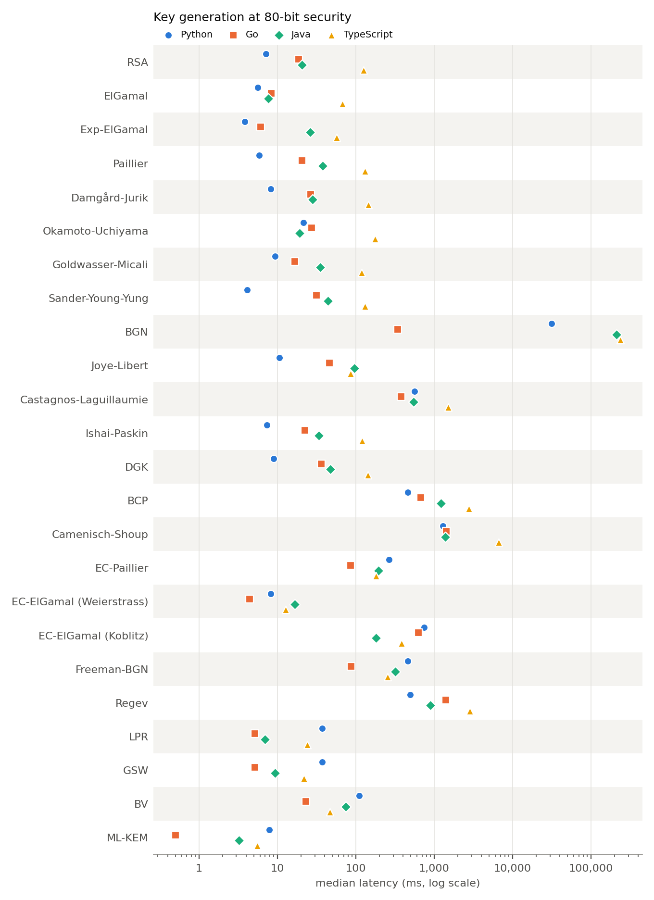


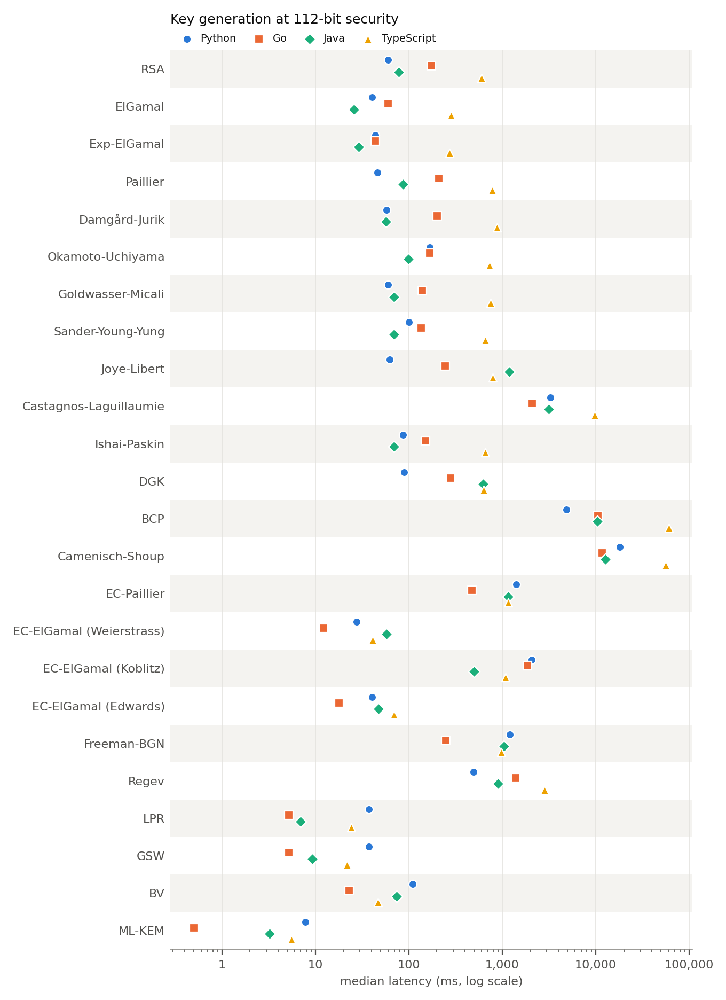


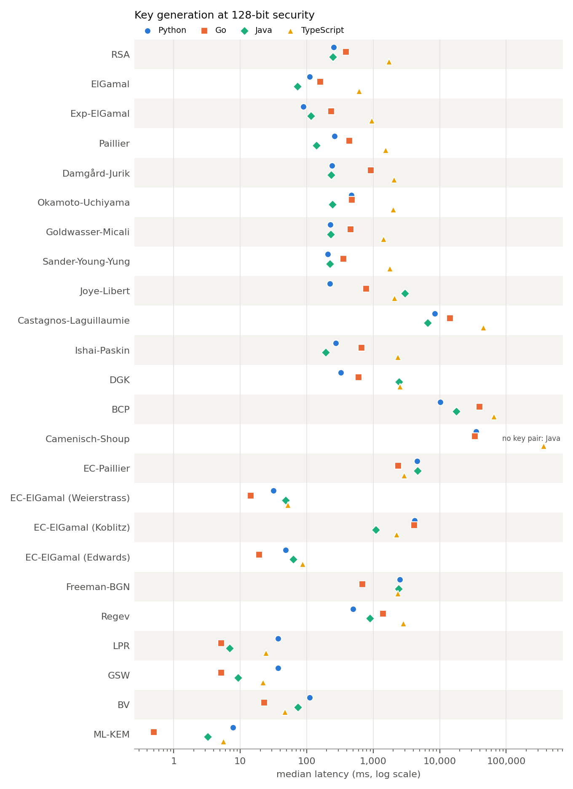


## Key and ciphertext sizes

Computed once from the Python run: the four ports use the same parameters and the same JSON serialization format, so sizes do not depend on the language. Plaintexts are 17 and 23 (single bits for bitwise schemes).

| Scheme | Level | Parameter | Public key | Private key | Ciphertext | Ciphertext (JSON) |
|---|---|---|---|---|---|---|
| RSA | 80-bit | 1024 | 256 B | 128 B | 128 B | 308 B |
| RSA | 112-bit | 2048 | 512 B | 256 B | 256 B | 616 B |
| RSA | 128-bit | 3072 | 768 B | 384 B | 384 B | 924 B |
| ElGamal | 80-bit | 1024 | 160 B | 64 B | 128 B | 342 B |
| ElGamal | 112-bit | 2048 | 320 B | 128 B | 256 B | 654 B |
| ElGamal | 128-bit | 3072 | 480 B | 192 B | 384 B | 962 B |
| Exp-ElGamal | 80-bit | 1024 | 160 B | 64 B | 128 B | 342 B |
| Exp-ElGamal | 112-bit | 2048 | 320 B | 128 B | 256 B | 651 B |
| Exp-ElGamal | 128-bit | 3072 | 479 B | 192 B | 384 B | 959 B |
| Paillier | 80-bit | 1024 | 256 B | 128 B | 256 B | 616 B |
| Paillier | 112-bit | 2048 | 512 B | 256 B | 512 B | 1.2 KiB |
| Paillier | 128-bit | 3072 | 768 B | 384 B | 767 B | 1.8 KiB |
| Damgård-Jurik | 80-bit | 1024 | 257 B | 128 B | 384 B | 923 B |
| Damgård-Jurik | 112-bit | 2048 | 513 B | 256 B | 767 B | 1.8 KiB |
| Damgård-Jurik | 128-bit | 3072 | 769 B | 384 B | 1.1 KiB | 2.7 KiB |
| Okamoto-Uchiyama | 80-bit | 1024 | 576 B | 128 B | 192 B | 462 B |
| Okamoto-Uchiyama | 112-bit | 2048 | 1.1 KiB | 256 B | 384 B | 924 B |
| Okamoto-Uchiyama | 128-bit | 3072 | 1.7 KiB | 384 B | 575 B | 1.4 KiB |
| Goldwasser-Micali | 80-bit | 1024 | 256 B | 128 B | 128 B | 310 B |
| Goldwasser-Micali | 112-bit | 2048 | 512 B | 256 B | 256 B | 618 B |
| Goldwasser-Micali | 128-bit | 3072 | 768 B | 384 B | 384 B | 926 B |
| Sander-Young-Yung | 80-bit | 1024 | 257 B | 128 B | 14.6 KiB | 35.3 KiB |
| Sander-Young-Yung | 112-bit | 2048 | 513 B | 256 B | 40.5 KiB | 97.6 KiB |
| Sander-Young-Yung | 128-bit | 3072 | 769 B | 384 B | 48.7 KiB | 117.5 KiB |
| BGN | 80-bit | 1024 | 1.3 KiB | 130 B | 260 B | 657 B |
| Joye-Libert | 80-bit | 1024 | 258 B | 64 B | 127 B | 306 B |
| Joye-Libert | 112-bit | 2048 | 514 B | 128 B | 256 B | 617 B |
| Joye-Libert | 128-bit | 3072 | 770 B | 192 B | 384 B | 925 B |
| Castagnos-Laguillaumie | 80-bit | 1024 | 705 B | 71 B | 577 B | 1.5 KiB |
| Castagnos-Laguillaumie | 112-bit | 2048 | 1.4 KiB | 135 B | 1.1 KiB | 2.8 KiB |
| Castagnos-Laguillaumie | 128-bit | 3072 | 2.1 KiB | 199 B | 1.7 KiB | 4.2 KiB |
| Ishai-Paskin | 80-bit | 1024 | 257 B | 128 B | 383 B | 923 B |
| Ishai-Paskin | 112-bit | 2048 | 513 B | 256 B | 767 B | 1.8 KiB |
| Ishai-Paskin | 128-bit | 3072 | 769 B | 384 B | 1.1 KiB | 2.7 KiB |
| DGK | 80-bit | 1024 | 389 B | 168 B | 128 B | 308 B |
| DGK | 112-bit | 2048 | 773 B | 296 B | 256 B | 616 B |
| DGK | 128-bit | 3072 | 1.1 KiB | 424 B | 384 B | 925 B |
| BCP | 80-bit | 1024 | 640 B | 384 B | 512 B | 1.2 KiB |
| BCP | 112-bit | 2048 | 1.2 KiB | 768 B | 1.0 KiB | 2.4 KiB |
| BCP | 128-bit | 3072 | 1.9 KiB | 1.1 KiB | 1.5 KiB | 3.6 KiB |
| Camenisch-Shoup | 80-bit | 1024 | 1.5 KiB | 768 B | 512 B | 1.2 KiB |
| Camenisch-Shoup | 112-bit | 2048 | 3.0 KiB | 1.5 KiB | 1.0 KiB | 2.4 KiB |
| Camenisch-Shoup | 128-bit | 3072 | 4.5 KiB | 2.2 KiB | 1.5 KiB | 3.6 KiB |
| EC-Paillier | 80-bit | 1024 | 896 B | 256 B | 768 B | 1.8 KiB |
| EC-Paillier | 112-bit | 2048 | 1.8 KiB | 512 B | 1.5 KiB | 3.6 KiB |
| EC-Paillier | 128-bit | 3072 | 2.6 KiB | 767 B | 2.2 KiB | 5.5 KiB |
| EC-ElGamal (Weierstrass) | 80-bit | secp160r1 | 40 B | 20 B | 80 B | 301 B |
| EC-ElGamal (Weierstrass) | 112-bit | p224 | 56 B | 28 B | 112 B | 378 B |
| EC-ElGamal (Weierstrass) | 128-bit | p256 | 64 B | 32 B | 128 B | 416 B |
| EC-ElGamal (Koblitz) | 80-bit | k163 | 42 B | 21 B | 84 B | 304 B |
| EC-ElGamal (Koblitz) | 112-bit | k233 | 59 B | 29 B | 117 B | 389 B |
| EC-ElGamal (Koblitz) | 128-bit | k283 | 72 B | 36 B | 144 B | 449 B |
| EC-ElGamal (Edwards) | 112-bit | e222 | 56 B | 28 B | 112 B | 376 B |
| EC-ElGamal (Edwards) | 128-bit | ed25519 | 64 B | 32 B | 128 B | 416 B |
| Freeman-BGN | 80-bit | |p|=512 | 1.3 KiB | 96 B | 384 B | 1.0 KiB |
| Freeman-BGN | 112-bit | |p|=1024 | 2.7 KiB | 96 B | 768 B | 1.9 KiB |
| Freeman-BGN | 128-bit | |p|=1536 | 4.0 KiB | 96 B | 1.1 KiB | 2.9 KiB |
| Regev | 80-bit | n=2048, log q=50, est. 139-bit | 13.6 KiB | 2.0 KiB | 13.5 KiB | 32.0 KiB |
| Regev | 112-bit | n=2048, log q=50, est. 139-bit | 13.6 KiB | 2.0 KiB | 13.5 KiB | 32.0 KiB |
| Regev | 128-bit | n=2048, log q=50, est. 139-bit | 13.6 KiB | 2.0 KiB | 13.5 KiB | 32.0 KiB |
| LPR | 80-bit | n=2048, log q=50, est. 139-bit | 13.5 KiB | 2.0 KiB | 13.5 KiB | 32.1 KiB |
| LPR | 112-bit | n=2048, log q=50, est. 139-bit | 13.5 KiB | 2.0 KiB | 13.5 KiB | 32.1 KiB |
| LPR | 128-bit | n=2048, log q=50, est. 139-bit | 13.5 KiB | 2.0 KiB | 13.5 KiB | 32.1 KiB |
| GSW | 80-bit | n=2048, log q=50, est. 139-bit | 13.5 KiB | 2.0 KiB | 270.0 KiB | 641.4 KiB |
| GSW | 112-bit | n=2048, log q=50, est. 139-bit | 13.5 KiB | 2.0 KiB | 270.0 KiB | 641.4 KiB |
| GSW | 128-bit | n=2048, log q=50, est. 139-bit | 13.5 KiB | 2.0 KiB | 270.0 KiB | 641.4 KiB |
| BV | 80-bit | n=4096, log q=100, est. 139-bit | 51.8 KiB | 4.0 KiB | 103.5 KiB | 249.1 KiB |
| BV | 112-bit | n=4096, log q=100, est. 139-bit | 51.8 KiB | 4.0 KiB | 103.5 KiB | 249.1 KiB |
| BV | 128-bit | n=4096, log q=100, est. 139-bit | 51.8 KiB | 4.0 KiB | 103.5 KiB | 249.1 KiB |
| ML-KEM | 80-bit | ML-KEM-512 (NIST cat. 1) | 1.0 KiB | 512 B | 1.4 KiB | 3.6 KiB |
| ML-KEM | 112-bit | ML-KEM-512 (NIST cat. 1) | 1.0 KiB | 512 B | 1.4 KiB | 3.6 KiB |
| ML-KEM | 128-bit | ML-KEM-512 (NIST cat. 1) | 1.0 KiB | 512 B | 1.4 KiB | 3.6 KiB |


## Peak memory

Baseline peak RSS (runtime + library loaded, no work): Python 43.3 MiB, Go 4.2 MiB, Java 27.9 MiB, TypeScript 43.9 MiB

| Scheme | 80-bit Python | 80-bit Go | 80-bit Java | 80-bit TypeScript | 112-bit Python | 112-bit Go | 112-bit Java | 112-bit TypeScript | 128-bit Python | 128-bit Go | 128-bit Java | 128-bit TypeScript |
|---|---|---|---|---|---|---|---|---|---|---|---|---|
| RSA | 0.2 | 4.6 | 59.4 | 7.4 | 0.3 | 4.7 | 91.9 | 7.9 | 0.2 | 5.1 | 170.3 | 8.1 |
| ElGamal | 0.5 | 5.1 | 48.2 | 6.8 | 0.4 | 5.0 | 92.9 | 6.8 | 0.2 | 5.1 | 102.1 | 6.6 |
| Exp-ElGamal | 0.2 | 4.6 | 74.7 | 6.8 | 0.3 | 4.9 | 97.9 | 7.8 | 0.1 | 4.8 | 141.2 | 8.0 |
| Paillier | 0.2 | 4.2 | 83.1 | 8.5 | 0.5 | 5.3 | 183.1 | 8.5 | 0.5 | 4.9 | 257.8 | 15.0 |
| Damgård-Jurik | 0.3 | 4.9 | 135.3 | 8.7 | 0.5 | 4.4 | 219.1 | 8.1 | 0.5 | 5.2 | 270.0 | 15.4 |
| Okamoto-Uchiyama | 0.2 | 4.7 | 86.6 | 8.2 | 0.2 | 5.7 | 169.5 | 8.9 | 0.5 | 5.0 | 220.5 | 9.1 |
| Goldwasser-Micali | 0.5 | 4.2 | 70.4 | 7.9 | 0.6 | 4.6 | 105.6 | 8.4 | 0.3 | 5.1 | 261.3 | 8.4 |
| Sander-Young-Yung | 0.5 | 6.4 | 182.9 | 19.8 | 1.1 | 5.7 | 179.6 | 39.7 | 1.0 | 5.8 | 244.2 | 39.9 |
| BGN | 0.6 | 7.1 | 182.2 | 38.4 |  |  |  |  |  |  |  |  |
| Joye-Libert | 0.3 | 6.2 | 176.4 | 9.5 | 0.3 | 6.8 | 176.2 | 9.9 | 0.5 | 6.0 | 243.5 | 11.5 |
| Castagnos-Laguillaumie | 0.4 | 8.9 | 178.1 | 35.7 | 0.4 | 8.1 | 216.4 | 36.2 | 0.4 | 7.6 | 335.2 | 37.5 |
| Ishai-Paskin | 0.1 | 5.4 | 137.5 | 8.9 | 0.5 | 4.8 | 222.5 | 8.6 | 0.5 | 4.8 | 271.8 | 7.9 |
| DGK | 10.6 | 16.3 | 99.2 | 40.2 | 16.4 | 23.2 | 173.2 | 42.4 | 21.7 | 33.7 | 275.2 | 48.3 |
| BCP | 0.4 | 5.8 | 175.4 | 11.1 | 0.8 | 7.5 | 221.1 | 18.6 | 0.8 | 7.1 | 267.7 | 17.5 |
| Camenisch-Shoup | 0.3 | 6.6 | 178.6 | 11.1 | 0.8 | 7.6 | 304.6 | 18.0 | 0.7 | 6.1 | keygen_error | 36.4 |
| EC-Paillier | 1.3 | 7.0 | 178.9 | 17.3 | 4.1 | 21.6 | 283.0 | 37.6 | 8.6 | 42.3 | 265.4 | 40.3 |
| EC-ElGamal (Weierstrass) | 0.4 | 6.4 | 197.6 | 8.0 | 0.1 | 5.8 | 175.8 | 9.0 | 0.2 | 5.3 | 174.9 | 10.2 |
| EC-ElGamal (Koblitz) | 0.1 | 6.3 | 222.8 | 17.4 | 0.0 | 6.3 | 225.7 | 18.2 | 0.0 | 6.4 | 226.3 | 17.8 |
| EC-ElGamal (Edwards) |  |  |  |  | 0.1 | 5.7 | 178.2 | 7.6 | 0.1 | 5.9 | 174.9 | 7.7 |
| Freeman-BGN | 1.2 | 6.5 | 181.8 | 22.3 | 1.8 | 7.2 | 178.6 | 39.7 | 2.1 | 9.4 | 178.3 | 41.9 |
| Regev | 152.2 | 149.5 | 279.0 | 167.5 | 152.2 | 149.5 | 279.0 | 167.5 | 152.2 | 149.5 | 279.0 | 167.5 |
| LPR | 4.0 | 7.1 | 180.3 | 46.8 | 4.0 | 7.1 | 180.3 | 46.8 | 4.0 | 7.1 | 180.3 | 46.8 |
| GSW | 17.0 | 21.4 | 300.6 | 112.4 | 17.0 | 21.4 | 300.6 | 112.4 | 17.0 | 21.4 | 300.6 | 112.4 |
| BV | 7.2 | 17.2 | 423.7 | 85.5 | 7.2 | 17.2 | 423.7 | 85.5 | 7.2 | 17.2 | 423.7 | 85.5 |
| ML-KEM | 0.8 | 6.1 | 179.9 | 25.4 | 0.8 | 6.1 | 179.9 | 25.4 | 0.8 | 6.1 | 179.9 | 25.4 |


## Package footprint

| Language | Library artifact | Runtime deps | Deps size | Source LOC | Binary / npm tarball |
|---|---|---|---|---|---|
| Python | 603.9 KiB | 4 | 25.5 MiB | 8,477 (+2,198 LightECC) |  |
| Go | 762.3 KiB | 0 | 0 B | 17,256 | 3.1 MiB |
| Java | 431.3 KiB | 1 | 67.8 KiB | 16,462 |  |
| TypeScript | 1.1 MiB | 0 | 0 B | 14,511 | 425.9 KiB |


## Lattice parameter sweep, ML-KEM parameter sets, learning-only GHV

| Scheme | n / set | Operation | Python | Go | Java | TypeScript |
|---|---|---|---|---|---|---|
| BV | 2048 | Key generation | 56.0 ms | 11.4 ms | 42.8 ms | 30.7 ms |
| BV | 2048 | Encryption | 97.2 ms | 16.5 ms | 29.2 ms | 36.8 ms |
| BV | 2048 | Decryption | 421 µs | 229 µs | 226 µs | 135 µs |
| BV | 2048 | Homomorphic addition | 738 µs | 1.11 ms | 746 µs | 773 µs |
| BV | 2048 | Homomorphic multiplication | 104 ms | 25.9 ms | 40.8 ms | 23.0 ms |
| BV | 2048 | Scalar multiplication | 686 µs | 1.02 ms | 769 µs | 1.07 ms |
| BV | 2048 | Re-encryption | 98.2 ms | 18.1 ms | 29.6 ms | 37.2 ms |
| BV | 4096 | Key generation | 110 ms | 23.1 ms | 74.2 ms | 46.8 ms |
| BV | 4096 | Encryption | 199 ms | 36.3 ms | 56.0 ms | 56.6 ms |
| BV | 4096 | Decryption | 659 µs | 361 µs | 234 µs | 209 µs |
| BV | 4096 | Homomorphic addition | 1.09 ms | 1.62 ms | 1.27 ms | 1.21 ms |
| BV | 4096 | Homomorphic multiplication | 233 ms | 55.5 ms | 80.6 ms | 37.5 ms |
| BV | 4096 | Scalar multiplication | 1.14 ms | 1.71 ms | 1.37 ms | 1.64 ms |
| BV | 4096 | Re-encryption | 201 ms | 38.1 ms | 57.9 ms | 59.1 ms |
| BV | 8192 | Key generation | 292 ms | 81.6 ms | 242 ms | 131 ms |
| BV | 8192 | Encryption | 542 ms | 141 ms | 200 ms | 163 ms |
| BV | 8192 | Decryption | 1.28 ms | 1.03 ms | 689 µs | 574 µs |
| BV | 8192 | Homomorphic addition | 2.22 ms | 5.41 ms | 3.38 ms | 3.35 ms |
| BV | 8192 | Homomorphic multiplication | 684 ms | 215 ms | 287 ms | 108 ms |
| BV | 8192 | Scalar multiplication | 2.38 ms | 5.00 ms | 3.44 ms | 4.47 ms |
| BV | 8192 | Re-encryption | 555 ms | 148 ms | 204 ms | 167 ms |
| GSW | 1024 | Key generation | 16.2 ms | 1.52 ms | 7.83 ms | 12.0 ms |
| GSW | 1024 | Encryption | 262 ms | 23.7 ms | 26.0 ms | 149 ms |
| GSW | 1024 | Decryption | 191 µs | 155 µs | 332 µs | 28.2 µs |
| GSW | 1024 | Homomorphic AND | 541 ms | 35.2 ms | 110 ms | 160 ms |
| GSW | 1024 | Homomorphic multiplication | 544 ms | 36.6 ms | 110 ms | 159 ms |
| GSW | 1024 | Homomorphic XOR | 3.69 ms | 2.20 ms | 1.31 ms | 556 µs |
| GSW | 1024 | Re-encryption | 264 ms | 26.6 ms | 27.6 ms | 147 ms |
| GSW | 2048 | Key generation | 37.2 ms | 5.18 ms | 9.35 ms | 21.9 ms |
| GSW | 2048 | Encryption | 605 ms | 88.8 ms | 82.5 ms | 311 ms |
| GSW | 2048 | Decryption | 392 µs | 306 µs | 754 µs | 55.0 µs |
| GSW | 2048 | Homomorphic AND | 1.56 s | 143 ms | 534 ms | 337 ms |
| GSW | 2048 | Homomorphic multiplication | 1.54 s | 157 ms | 528 ms | 338 ms |
| GSW | 2048 | Homomorphic XOR | 7.55 ms | 4.22 ms | 2.90 ms | 1.26 ms |
| GSW | 2048 | Re-encryption | 608 ms | 92.9 ms | 84.5 ms | 312 ms |
| GSW | 4096 | Key generation | 63.9 ms | 13.8 ms | 16.5 ms | 32.8 ms |
| GSW | 4096 | Encryption | 1.12 s | 252 ms | 208 ms | 464 ms |
| GSW | 4096 | Decryption | 554 µs | 462 µs | 1.12 ms | 80.9 µs |
| GSW | 4096 | Homomorphic AND | 3.24 s | 479 ms | 1.56 s | 541 ms |
| GSW | 4096 | Homomorphic multiplication | 3.22 s | 511 ms | 1.54 s | 543 ms |
| GSW | 4096 | Homomorphic XOR | 11.0 ms | 6.93 ms | 5.24 ms | 1.96 ms |
| GSW | 4096 | Re-encryption | 1.14 s | 261 ms | 211 ms | 469 ms |
| LPR | 1024 | Key generation | 17.0 ms | 1.54 ms | 6.30 ms | 11.5 ms |
| LPR | 1024 | Encryption | 16.3 ms | 1.25 ms | 1.70 ms | 8.83 ms |
| LPR | 1024 | Decryption | 184 µs | 5.87 µs | 25.0 µs | 29.1 µs |
| LPR | 1024 | Homomorphic addition | 184 µs | 69.3 µs | 58.0 µs | 39.8 µs |
| LPR | 1024 | Scalar multiplication | 201 µs | 63.6 µs | 41.0 µs | 66.9 µs |
| LPR | 1024 | Re-encryption | 16.5 ms | 1.30 ms | 1.58 ms | 8.83 ms |
| LPR | 2048 | Key generation | 37.3 ms | 5.20 ms | 6.92 ms | 24.2 ms |
| LPR | 2048 | Encryption | 35.8 ms | 4.61 ms | 4.98 ms | 18.5 ms |
| LPR | 2048 | Decryption | 414 µs | 11.9 µs | 56.6 µs | 58.9 µs |
| LPR | 2048 | Homomorphic addition | 344 µs | 139 µs | 103 µs | 79.7 µs |
| LPR | 2048 | Scalar multiplication | 404 µs | 129 µs | 78.1 µs | 132 µs |
| LPR | 2048 | Re-encryption | 36.0 ms | 4.70 ms | 4.67 ms | 18.7 ms |
| LPR | 4096 | Key generation | 64.0 ms | 13.3 ms | 15.8 ms | 32.5 ms |
| LPR | 4096 | Encryption | 63.4 ms | 12.9 ms | 11.3 ms | 28.5 ms |
| LPR | 4096 | Decryption | 567 µs | 18.4 µs | 87.8 µs | 80.7 µs |
| LPR | 4096 | Homomorphic addition | 503 µs | 197 µs | 153 µs | 114 µs |
| LPR | 4096 | Scalar multiplication | 550 µs | 186 µs | 130 µs | 189 µs |
| LPR | 4096 | Re-encryption | 63.9 ms | 13.1 ms | 10.9 ms | 28.2 ms |
| ML-KEM | 512 | Key generation | 7.85 ms | 503 µs | 3.25 ms | 5.57 ms |
| ML-KEM | 512 | Encryption | 8.06 ms | 492 µs | 628 µs | 4.52 ms |
| ML-KEM | 512 | Decryption | 852 µs | 167 µs | 117 µs | 414 µs |
| ML-KEM | 512 | Homomorphic XOR | 97.9 µs | 96.3 µs | 31.3 µs | 26.4 µs |
| ML-KEM | 512 | Re-encryption | 7.99 ms | 589 µs | 552 µs | 4.40 ms |
| ML-KEM | 768 | Key generation | 12.7 ms | 1.10 ms | 6.23 ms | 8.58 ms |
| ML-KEM | 768 | Encryption | 12.6 ms | 890 µs | 964 µs | 7.10 ms |
| ML-KEM | 768 | Decryption | 1.27 ms | 266 µs | 166 µs | 782 µs |
| ML-KEM | 768 | Homomorphic XOR | 134 µs | 130 µs | 41.8 µs | 37.2 µs |
| ML-KEM | 768 | Re-encryption | 12.8 ms | 1.08 ms | 932 µs | 7.18 ms |
| ML-KEM | 1024 | Key generation | 18.7 ms | 1.94 ms | 10.0 ms | 11.8 ms |
| ML-KEM | 1024 | Encryption | 18.3 ms | 1.54 ms | 1.59 ms | 10.0 ms |
| ML-KEM | 1024 | Decryption | 1.63 ms | 326 µs | 242 µs | 992 µs |
| ML-KEM | 1024 | Homomorphic XOR | 175 µs | 159 µs | 51.3 µs | 46.2 µs |
| ML-KEM | 1024 | Re-encryption | 18.4 ms | 1.71 ms | 1.39 ms | 10.3 ms |
| Regev | 1024 | Key generation | 97.2 ms | 375 ms | 232 ms | 715 ms |
| Regev | 1024 | Encryption | 16.9 ms | 1.01 ms | 1.79 ms | 13.8 ms |
| Regev | 1024 | Decryption | 127 µs | 5.91 µs | 35.8 µs | 13.9 µs |
| Regev | 1024 | Homomorphic addition | 152 µs | 71.1 µs | 86.3 µs | 39.5 µs |
| Regev | 1024 | Scalar multiplication | 202 µs | 62.3 µs | 56.1 µs | 40.8 µs |
| Regev | 1024 | Re-encryption | 17.5 ms | 1.10 ms | 1.68 ms | 13.7 ms |
| Regev | 2048 | Key generation | 495 ms | 1.40 s | 899 ms | 2.83 s |
| Regev | 2048 | Encryption | 41.9 ms | 3.74 ms | 5.21 ms | 40.2 ms |
| Regev | 2048 | Decryption | 221 µs | 11.9 µs | 46.7 µs | 32.2 µs |
| Regev | 2048 | Homomorphic addition | 352 µs | 136 µs | 89.8 µs | 79.3 µs |
| Regev | 2048 | Scalar multiplication | 365 µs | 128 µs | 121 µs | 78.2 µs |
| Regev | 2048 | Re-encryption | 42.3 ms | 3.89 ms | 5.17 ms | 40.4 ms |
| Regev | 4096 | Key generation | 3.45 s | 4.39 s | 2.65 s | 8.47 s |
| Regev | 4096 | Encryption | 99.3 ms | 13.2 ms | 15.2 ms | 83.4 ms |
| Regev | 4096 | Decryption | 368 µs | 24.9 µs | 70.5 µs | 49.5 µs |
| Regev | 4096 | Homomorphic addition | 505 µs | 215 µs | 136 µs | 113 µs |
| Regev | 4096 | Scalar multiplication | 590 µs | 194 µs | 102 µs | 115 µs |
| Regev | 4096 | Re-encryption | 101 ms | 13.3 ms | 15.6 ms | 84.8 ms |
| GHV | 4 | Key generation | 1.40 s | 95.2 ms | 855 ms | 345 ms |
| GHV | 4 | Encryption | 139 ms | 2.20 ms | 7.46 ms | 79.2 ms |
| GHV | 4 | Decryption | 366 ms | 9.92 ms | 12.3 ms | 104 ms |
| GHV | 4 | Homomorphic addition | 4.43 ms | 2.60 ms | 4.29 ms | 639 µs |
| GHV | 4 | Homomorphic multiplication | 451 ms | 10.7 ms | 5.31 ms | 238 ms |
| GHV | 4 | Scalar multiplication | 4.78 ms | 2.31 ms | 5.00 ms | 1.29 ms |
| GHV | 4 | Re-encryption | 141 ms | 4.56 ms | 14.1 ms | 81.3 ms |


## ⚠ Excluded: too slow or no key pair

Each (scheme, parameter, language) pair has a hard wall-clock limit. Pairs that hit it are killed, excluded from the result tables (shown as `excl.`) and listed here. Pairs whose randomized key search exhausted `max_tries` in every attempt within the key generation budget are listed too (shown as `fail`). The other languages for the same scheme are still reported.

| Run | Language | Where | Reason |
|---|---|---|---|
| `Camenisch-Shoup|3072` | Java | full run | no key pair: 2 of 2 attempts failed (54 s, 108 s): Failed to find a 1536-bit safe prime |


## Excluded schemes

- **Benaloh**: Key generation samples random primes until the block size r (~1000-2000) divides p-1, i.e. ~r prime pairs per key. The pilot took 200 s at 1024 bits in TypeScript and did not finish 2048 bits within the limit. Go builds p = 1 mod r directly, so key generation differs algorithmically between ports.
- **Naccache-Stern**: Randomized key search over smooth moduli. In the pilot Java exhausted max_tries=10000 at 1024 bits, while Python (26 s) and Go (11 s) succeeded.


Run at small keys only:

- **Boneh-Goh-Nissim**: 80-bit level only; not run: Python key generation took 208 s at 1024 bits and grows roughly cubically with the modulus (same algorithm in every port).


## Parameter equivalence across ports

Bit lengths of plaintext / ciphertext moduli are compared across ports. Prime generators differ slightly (e.g. Go forces the top bit, Python draws from a range), so moduli may vary by a few bits. Largest relative difference of the ciphertext modulus between ports: 0.78% (`Sander-Young-Yung|1024`). Runs differing by more than 1%:

None, so all ports run equivalent parameters.


## Failures and inconsistencies

- keygen_error Java `Camenisch-Shoup|3072`: Failed to find a 1536-bit safe prime


## Threats to validity

- Single machine, a laptop CPU with turbo boost and thermal throttling. Use absolute numbers
  as indicative, and ratios between languages, which are measured interleaved, as the more robust result.
- Go 1.17 is an old toolchain. Newer Go releases have faster `math/big` assembly on some
  platforms.
- The JVM runs with default flags (tiered JIT, G1). Long warm-ups could favour Java more on
  sub-millisecond operations.
- Key generation time of prime-search based schemes has heavy-tailed variance, so medians over
  at most 10 samples carry wide uncertainty. The key generation section shows the min-max spread.
- Lattice security levels are estimates from a closed-form rule, not from the lattice-estimator.
  Validate them with the lattice-estimator before quoting bit-security in a paper.
- Okamoto-Uchiyama's modulus n = p^2 q gives slightly weaker factoring security than an RSA
  modulus of the same size.


## Reproduce

| Path | What |
|---|---|
| `build.sh` | builds the Go, Java and TypeScript drivers against local checkouts of the ports |
| `gen_cases.py` | schemes, security tiers, parameters and exclusions (generated into `config/cases.json` on first use) |
| `drivers/{python,go,java,ts}/` | one benchmark driver per language, same protocol (`key=value` args, `@@BENCH` JSON events) |
| `run.py` | orchestrator: one process per (run, language), hard timeout, peak RSS via `wait4`, resumable |
| `footprint.py` | package size, dependencies, lines of code |
| `analyze.py` | statistics, figures and this README |

The *Highlights* section is written by hand: edit it directly in this README, and `analyze.py`
keeps it when it regenerates the rest of the page. Measurements are written to `results/` (raw samples, `summary.csv` with full statistics,
`runs.csv`), which is not committed. `python analyze.py --pdf` also writes vector figures, and
`--tables` writes every table as `.md` and booktabs `.tex`, both meant for a paper.

Clone the implementations side by side. By default this is a `github` folder next to this repository:

```
<parent>/
  lightphe-benchmarks/   (this repo)
  github/LightPHE  github/LightECC  github/lightphe-go  github/lightphe4j  github/lightphe-ts
```

Requirements: Python with LightPHE installed (e.g. `pip install -e github/LightPHE`) plus
matplotlib, Go, JDK 17+, Node.js. Settings, all optional:

| Variable | Default | Meaning |
|---|---|---|
| `LIGHTPHE_GITHUB` | `../github` | folder holding the five checkouts |
| `LIGHTPHE_PYTHON` | the interpreter running `run.py` | Python used for the Python driver |
| `LIGHTPHE_JAVA_HOME` | `lightphe4j/scripts/java-home.sh`, then `JAVA_HOME` | JDK 17+ |
| `LIGHTPHE_TS_DIST` | `$LIGHTPHE_GITHUB/lightphe-ts/dist/esm/index.js` | lightphe-ts build |

```sh
./build.sh                       # Go binary, lightphe4j jar + classpath + Java driver, lightphe-ts dist
caffeinate -i -s python run.py --quick --timeout 300 --out results/pilot    # pilot, 1 sample each
caffeinate -i -s python run.py --timeout 900 --skip-slow-from results/pilot  # full run
python footprint.py
python analyze.py                # this README and figures/
```

`run.py` resumes after an interruption. `--redo` starts over, and `--only <substring>` and `--langs` select
subsets. Keep the machine awake (`caffeinate` on macOS): sleep pauses the timers and corrupts
the samples in progress. Don't run the benchmark in hosted CI. It is hours of CPU-bound work and
belongs on a dedicated machine.

# Citation

Please cite LightPHE in your publications if it helps your research. Here is its BibTex entry:

```BibTeX
@article{lightphe,
  title          = {Sustainable Cryptography: Carbon Asymmetry in Partially Homomorphic Encryption in the Cloud},
  author         = {Ozpinar, Alper and Serengil, Sefik Ilkin},
  journal        = {Symmetry},
  volume         = {18},
  number         = {5},
  pages          = {832},
  url            = {https://www.mdpi.com/2073-8994/18/5/832},
  doi            = {10.3390/sym18050832},
  note           = {Special Issue: Symmetry in Cryptography and Cybersecurity},
  year           = {2026}
}
```

# License

This benchmark is licensed under the MIT License - see [`LICENSE`](LICENSE) for more details.
